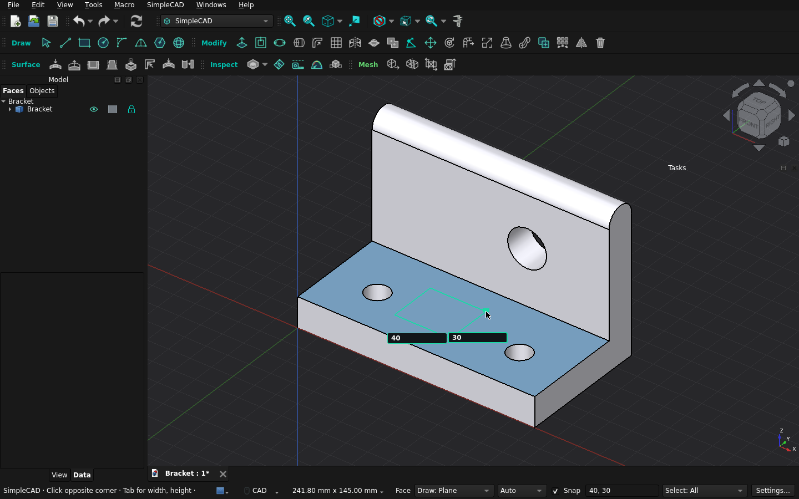

# SimpleCAD

**Direct modeling for FreeCAD, in the spirit of SketchUp.** Draw a shape, pull
it into a solid, then keep editing its faces and edges directly. There are no
sketches, constraints or feature tree to manage, and imported STL meshes can be
edited as they are.

[](https://www.freecad.org)
[](LICENSE)

[](https://github.com/igsova/SimpleCAD/actions/workflows/tests.yml)
[](https://github.com/igsova/SimpleCAD/actions/workflows/lint.yml)



## Features

- **Draw and pull.** Line, Rectangle, Circle, Arc, Polygon and Sphere. Lines
  and outlines can also be drawn directly on curved faces. Push/Pull turns any
  flat region into a boss, a pocket or a through-hole. Type exact sizes with
  units (`40, 30`, `2 cm`, `1 in`) at any point while drawing.
- **Edit any shape.** Divide faces with lines, then offset, round, slice,
  union, intersect, bend, scale, loft, sweep, mirror or pattern them. This
  works on any plain Part shape, including converted STL meshes.
- **Curved surfaces.** Draw on curved faces, offset them, shell or thicken a
  part, add draft, remove fillets, fill holes, unwrap a face, and show a
  curvature map.
- **STL meshes without conversion.** Split a mesh with an optional glue seam,
  stretch it between two planes, or move, rotate and extrude a patch of
  triangles. When you need CAD faces, **Make mesh editable** fits planes,
  cylinders and smooth surfaces.
- **Snapping and measuring.** Snap to endpoints, midpoints, face and hole
  centers and the X/Y/Z axes. Measure hole diameters, spacing, distances and
  angles, and leave dimensions in the view. Measure Tape leaves dashed guides
  to draw against, as in SketchUp.
- **Plain FreeCAD files.** Results are ordinary Part and Mesh objects in
  `.FCStd` documents that open without SimpleCAD installed. Every edit is one
  Undo step.
- **AI-ready.** A local [MCP](docs/mcp.md) server lets AI clients such as
  Claude or Codex inspect and edit the open model with the same operations as
  the toolbar.


https://github.com/user-attachments/assets/3ee6a401-5bb9-443b-8c6b-4076e62b04a1


## Requirements

- FreeCAD **1.1** or later. SimpleCAD is developed with FreeCAD 1.1.3.
- Nothing else to install: FreeCAD's own installers include Python,
  OpenCascade, Qt, Coin, NumPy and SciPy. A FreeCAD from a Linux distribution
  package may need its `numpy` and `scipy` Python packages installed too.
- Developed and used on macOS. The automated tests also run on Linux. Windows
  has not been tested yet; reports are welcome.

## Install

### Addon Manager

1. In FreeCAD, open **Edit → Preferences → Addon Manager**.
2. Under **Custom repositories**, add `https://github.com/igsova/SimpleCAD`
   with branch `main`.
3. Open **Tools → Addon manager**, find **SimpleCAD** and install it.
4. Restart FreeCAD, then switch to the SimpleCAD workbench: pick **SimpleCAD**
   in the workbench list on the toolbar (it shows the current workbench, such
   as **Part Design**), or choose **View → Workbench → SimpleCAD**.

### Manual

Clone or unzip the repository into FreeCAD's `Mod` folder, so that
`InitGui.py` sits directly inside `Mod/SimpleCAD`:

```sh
git clone https://github.com/igsova/SimpleCAD.git "<Mod folder>/SimpleCAD"
```

To find the `Mod` folder, open **View → Panels → Python console** in FreeCAD
and run `App.getUserAppDataDir()`; `Mod` is inside the folder it prints.
For FreeCAD 1.1 it is usually:

| System | Mod folder |
| --- | --- |
| macOS | `~/Library/Application Support/FreeCAD/v1-1/Mod` |
| Linux | `~/.local/share/FreeCAD/v1-1/Mod` |
| Windows | `%APPDATA%\FreeCAD\v1-1\Mod` |

On macOS, `python3 scripts/install_macos.py` from a clone asks FreeCAD for this
folder and links the clone there. Add `--copy` for an independent copy, or
`--uninstall` to remove the link.

## Quick start

1. Switch to the **SimpleCAD** workbench (see Install above) and click
   **Rectangle** (or press **R** with the 3D view focused). Click a corner,
   press **Tab** and type `40, 30`: the width and height go into two boxes on
   the rectangle's sides, and the comma moves from one to the other. Press
   **Enter**.
2. Press **P** (Push/Pull), click the rectangle, press **Tab**, type `20` and
   press **Enter**. You now have a 40 × 30 × 20 mm block.
3. Press **L** (Line), click the midpoint of one top edge, then the midpoint
   of the opposite edge. The top face is now two regions. Press **P** and pull
   one of them up.
4. Press **O** (Circle), click on the lower region for the center, type `5` for
   the radius and press **Enter**. Press **P** and drag the circle down until
   the status bar says **On opposite face**, then release to make a
   through-hole.
5. **Esc** cancels the current step, and **⌘Z** or **Ctrl+Z** undoes the last
   edit.

The [user guide](docs/user-guide.md) covers every tool.

## Tools

| Group | Tools |
| --- | --- |
| **Draw** | Select, Line, Rectangle, Circle, Arc, 2 Point Arc, Polygon, Sphere |
| **Modify** | Push/Pull, Offset, Elongate, Fit Circle / Cylinder, Round edges, Subdivide face, Slice / Separate (with printable stud joints), Intersect Faces, Union, Move Vertex, Move, Rotate, Bend / Soft Deform, Scale / Stretch, Loft, Sweep, Copy, Pattern, Mirror, Delete, Color & opacity, Merge coincident geometry, Heal to precision |
| **Surface** | Draw on surface, Offset face, Shell / Thicken, Draft faces, Delete & heal faces, Remove rounds, Fill hole, Unwrap face |
| **Inspect** | Smart select, Measure, Measure Tape, Curvature map, Isolate selection |
| **Mesh** | Make mesh editable, Split mesh, Stretch mesh, Mesh region (Move / Rotate / Extrude) |

Single-letter shortcuts work while the 3D view has focus; see the
[tool reference](docs/user-guide.md#tools).

## Limitations

- Tools edit plain Part shapes. For a parametric Part or PartDesign feature,
  make a **Part → Create a copy → Create simple copy** first.
- Push/Pull works on flat faces; use **Offset face** for curved ones.
- SimpleCAD is young and changes quickly. The fit of printed stud joints and
  glue seams has not been tested on a printer.

See the [roadmap](docs/roadmap.md) for planned work and the
[changelog](CHANGELOG.md) for what changed.

## Privacy and safety

- **Nothing leaves your computer.** SimpleCAD makes no network requests: no
  telemetry, no update checks and no accounts.
- **The AI connection is off until you start it.** **SimpleCAD → AI connection
  (MCP)…** starts a server that listens on `127.0.0.1` only and requires a new
  secret token each time. The AI client you connect sees the model details it
  asks for. Turn off **Allow model changes** to limit it to inspection. It
  stops when FreeCAD quits. See the [connection boundary](docs/mcp.md#connection-boundary).
- **Your model changes only when you apply.** Previews are temporary, each
  applied edit is a single Undo step, and a failed or cancelled edit leaves the
  model as it was. A mesh you convert is kept as a hidden backup. SimpleCAD
  never saves your document.
- **Heavy work runs in a separate process.** Mesh conversion, mesh edits and
  healing run in a background worker with a temporary folder that is removed
  afterwards, so a geometry kernel crash stops the worker, not FreeCAD.
- **Files stay plain FreeCAD.** Results are ordinary Part and Mesh objects, so
  a model opens without SimpleCAD installed.

## Development

```text
simplecad/
  core/         geometry helpers, coincidence, preferences
  modeling/     Part algorithms behind the Draw and Modify tools
  surfaces/     drawing on and editing curved faces
  mesh/         raw STL editing and mesh-to-CAD conversion
  repair/       Heal to precision
  inspection/   Measure and smart selection
  document/     undoable document writes, materials, locks, visibility
  jobs/         background worker processes
  mcp/          the local MCP server and bridge
  gui/          workbench, commands, controller, previews and tool panels
scripts/        workers, MCP server, installer and test runners
tests/          unit/, gui/ and benchmarks/
```

Run the unit tests with FreeCAD's own Python:

```sh
sh scripts/test_macos.sh                    # macOS, using /Applications/FreeCAD.app
PYTHONPATH=.:<FreeCAD>/lib <FreeCAD>/bin/python -m unittest discover -s tests/unit
ruff check .                                # lint, as CI runs it
```

Every push and pull request runs the unit tests on Linux with FreeCAD 1.1 from
conda-forge, and the lint check.

GUI suites run inside a FreeCAD window, one process per suite (with `xvfb-run`
on a headless Linux machine):

```sh
sh scripts/test_gui.sh gui_smoke gui_mesh_region   # or no names for all suites
```

Read [CONTRIBUTING.md](CONTRIBUTING.md) before opening a pull request. The
[architecture notes](docs/development/architecture.md) describe the design in
depth.

## License

[MIT](LICENSE).
