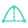
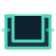

# Tools

Every SimpleCAD tool, grouped as on the toolbar. Each tool has a short clip, recorded with SimpleCAD 0.39.3.

## [Draw](draw.md)

| | Tool | Key | What it does |
| --- | --- | --- | --- |
| { .tool-icon } | [Select](draw.md#select) | <kbd>S</kbd> / <kbd>Esc</kbd> | Select picks faces, edges and vertices with a click, or many at once with a box. |
| { .tool-icon } | [Line](draw.md#line) | <kbd>L</kbd> | Line draws connected straight segments, one per click. |
| { .tool-icon } | [Rectangle](draw.md#rectangle) | <kbd>R</kbd> | Rectangle draws a filled rectangular face from two opposite corners. |
| { .tool-icon } | [Circle](draw.md#circle) | <kbd>O</kbd> | Circle draws a filled circle from its center and radius. |
| { .tool-icon } | [Arc](draw.md#arc) | <kbd>A</kbd> | Arc draws a circular arc from its center, a start point and an end point. |
| { .tool-icon } | [2 Point Arc](draw.md#arc2point) | <kbd>H</kbd> | 2 Point Arc draws an arc between two endpoints and lets you set how far it bulges from the straight line between them. |
| { .tool-icon } | [Polygon](draw.md#polygon) | <kbd>G</kbd> | Polygon draws a filled regular polygon from its center and one vertex. |
| { .tool-icon } | [Sphere](draw.md#sphere) | <kbd>B</kbd> | Sphere creates a complete, smooth solid ball from its center and radius. |
|  | [Snapping](draw.md#snapping) |  | While you draw, the pointer snaps to corners, edge midpoints and face centers of existing parts, so new lines and shapes start and end at exact points. |

## [Modify](modify.md)

| | Tool | Key | What it does |
| --- | --- | --- | --- |
| { .tool-icon } | [Push/Pull](modify.md#pushpull) | <kbd>P</kbd> | Push/Pull moves a flat face along its normal. |
| { .tool-icon } | [Offset](modify.md#offset) | <kbd>E</kbd> | Offset draws a parallel copy of a flat face's outline, or of a single straight edge, arc or circle. |
| { .tool-icon } | [Elongate / Make Elliptical](modify.md#elongate) | <kbd>X</kbd> | Elongate stretches a round hole, a hole rim or a flat face along a direction you choose, into an ellipse or a slot. |
| { .tool-icon } | [Fit Circle / Cylinder](modify.md#analytic) | <kbd>Y</kbd> | Fit Circle / Cylinder replaces faceted circular geometry with true circles and cylinders. |
| { .tool-icon } | [Round edges](modify.md#round) | <kbd>F</kbd> | Round edges replaces sharp edges with smooth rounds (fillets) of a radius you set, with a shaded preview before anything changes. |
| { .tool-icon } | [Subdivide face](modify.md#subdivide) | <kbd>D</kbd> | Subdivide face divides one flat face into triangles, a center fan, or a grid of evenly spaced cells. |
| { .tool-icon } | [Slice / Separate](modify.md#slice) | <kbd>U</kbd> | Slice / Separate cuts whole objects with a plane and can move the pieces apart. |
| { .tool-icon } | [Intersect Faces](modify.md#intersect) | <kbd>I</kbd> | Intersect Faces splits crossing faces along the lines where they meet, so you can delete the pieces you do not want. |
| { .tool-icon } | [Union](modify.md#union) | <kbd>J</kbd> | Union joins overlapping whole objects into one closed solid. |
| { .tool-icon } | [Move Vertex](modify.md#vertexmove) | <kbd>V</kbd> | Move Vertex drags one corner of a part and reshapes the flat faces around it. |
| { .tool-icon } | [Move](modify.md#move) | <kbd>M</kbd> | Move slides whole objects from a base point to a destination. |
| { .tool-icon } | [Rotate](modify.md#rotate) | <kbd>Q</kbd> | Rotate turns whole objects around a world axis or one of the object's own axes. |
| { .tool-icon } | [Bend / Soft Deform](modify.md#deform) | <kbd>N</kbd> | Bend / Soft Deform reshapes one object freely. |
| { .tool-icon } | [Scale / Stretch](modify.md#scale) | <kbd>K</kbd> | Scale / Stretch resizes whole objects by factors. |
| { .tool-icon } | [Loft](modify.md#loft) | <kbd>Shift</kbd>+<kbd>Q</kbd> | Loft connects two or more profiles, in order, into a new solid or surface. |
| { .tool-icon } | [Sweep](modify.md#sweep) | <kbd>W</kbd> | Sweep carries a profile along a path to make a new solid or surface, such as a pipe, a rail or a handle. |
| { .tool-icon } | [Copy](modify.md#copy) | <kbd>C</kbd> | Copy places an independent copy of the selected objects, using the same base point and destination interaction as Move. |
|  | [Copy, cut and paste](modify.md#clipboard) | <kbd>⌘C</kbd> / <kbd>⌘X</kbd> / <kbd>⌘V</kbd> | ⌘C, ⌘X and ⌘V (Ctrl+C, Ctrl+X and Ctrl+V on Windows and Linux) copy, cut and paste whole objects. |
| { .tool-icon } | [Pattern](modify.md#pattern) |  | Pattern repeats whole objects in a grid, around an axis, or along a path in one step. |
| { .tool-icon } | [Mirror](modify.md#mirror) |  | Mirror flips whole objects along X, Y or Z. |
| { .tool-icon } | [Delete](modify.md#delete) | <kbd>Delete</kbd> / <kbd>Backspace</kbd> | Delete erases the selected edges, faces or objects. |

## [Surface](surface.md)

| | Tool | Key | What it does |
| --- | --- | --- | --- |
| { .tool-icon } | [Draw on surface](surface.md#imprint) |  | Draw on surface puts a rectangle, circle, polygon or text onto curved or flat faces. |
| { .tool-icon } | [Offset face](surface.md#offsetface) |  | Offset face moves faces of a solid, flat or curved, along their own normals by a distance. |
| { .tool-icon } | [Shell](surface.md#shell) |  | Shell hollows a closed solid inward, leaving walls of the thickness you enter. |
| { .tool-icon } | [Thicken](surface.md#thicken) |  | Thicken turns a surface object, made of faces with no solid inside, into a solid wall of the thickness you enter. |
| { .tool-icon } | [Draft faces](surface.md#draft) |  | Draft faces tilts flat or round side walls of a solid by a small angle, so a moulded or cast part releases from its mould. |
| { .tool-icon } | [Delete & heal faces](surface.md#healfaces) |  | Delete & heal faces removes selected faces of a solid, such as a boss, a pocket, a hole or a round, and grows the neighbouring faces until the solid is closed again. |
| { .tool-icon } | [Remove rounds](surface.md#removerounds) |  | Remove rounds finds rounded edges (fillets) up to a radius and removes them, so the corners are sharp again. |
| { .tool-icon } | [Fill hole](surface.md#fillhole) |  | Fill hole closes the openings of an open surface with patches that blend smoothly into the faces around them. |
| { .tool-icon } | [Unwrap face](surface.md#unwrap) |  | Unwrap face flattens one face into a new flat face beside the part, for a template, a label or a cut sheet. |

## [Inspect](inspect.md)

| | Tool | Key | What it does |
| --- | --- | --- | --- |
|  | [Smart select](inspect.md#smartselect) |  | Smart select grows one face or edge into what you most likely meant: a whole hole, an edge loop, a flat region or a smooth curved surface. |
| { .tool-icon } | [Measure](inspect.md#measure) | <kbd>Z</kbd> | Measure reads sizes from the model without changing it: a hole's diameter, an edge's length, a face's area, the radius of a curve, and distances and angles between two picks. |
| { .tool-icon } | [Measure Tape](inspect.md#tape) | <kbd>T</kbd> | Measure Tape measures out from an edge or a point and leaves a dashed guide there, as SketchUp's Tape Measure does. |
| { .tool-icon } | [Curvature map](inspect.md#curvature) |  | Curvature map colours curved faces by how tightly they bend, from red for tight bends through yellow and green to blue for gentle ones. |
| { .tool-icon } | [Isolate selection](inspect.md#isolate) |  | Isolate selection hides every object except the selected ones, so you can work on one part of a crowded model. |

## [Mesh](mesh.md)

| | Tool | Key | What it does |
| --- | --- | --- | --- |
| { .tool-icon } | [Make mesh editable](mesh.md#convertmesh) |  | Make mesh editable rebuilds an imported STL mesh as CAD faces that you can select and edit with the modeling tools. |
| { .tool-icon } | [Split mesh](mesh.md#meshsplit) |  | Split mesh cuts an STL mesh into two mesh objects along a plane, without converting it to CAD faces. |
| { .tool-icon } | [Stretch mesh / Move region](mesh.md#meshstretch) |  | Stretch mesh lengthens or shortens an STL mesh between two planes while both ends keep their shape. |
| { .tool-icon } | [Mesh region · Move / Rotate / Extrude](mesh.md#meshregion) |  | Mesh region edits a patch of an STL mesh directly. |

## [Panels and settings](panels.md)

| | Tool | Key | What it does |
| --- | --- | --- | --- |
|  | [Faces and Objects panels](panels.md#facespanel) |  | The Faces tab lists the shapes in the active document and, when you expand one, each of its faces. |
|  | [Lock faces and objects](panels.md#lock) |  | A padlock protects geometry from accidental edits. |
|  | [Show or hide](panels.md#visibility) |  | The eyes in the Faces tab hide or show whole objects or single faces. |
|  | [Color & opacity](panels.md#appearance) |  | Color & opacity sets the surface color and transparency of faces or whole objects. |
|  | [Merge coincident geometry](panels.md#cleanup) |  | Merge coincident geometry removes duplicate faces and lines that exactly cover other geometry, and joins open surfaces that share an edge into one object. |
|  | [Heal to precision](panels.md#heal) |  | Heal to precision snaps nearly parallel, axis-aligned or coplanar flat faces and slightly skewed holes to exact alignment. |
|  | [Settings](panels.md#settings) |  | Settings controls the viewport look, whether curved-surface seams are drawn, the modeling precision, and which snap targets are active and how far they reach. |
|  | [AI connection (MCP)](panels.md#mcp) |  | AI connection starts a local MCP server so that an AI client such as Codex can inspect your open models and edit them with SimpleCAD's own tools. |
