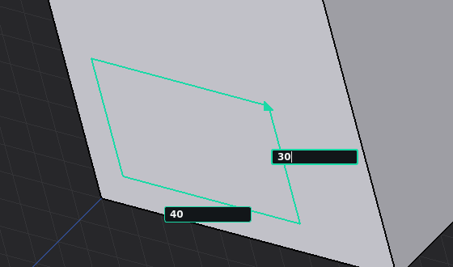
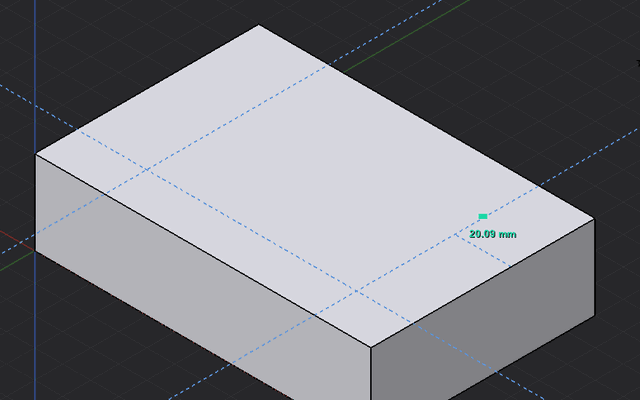

# SimpleCAD user guide

This guide covers every SimpleCAD tool. For installation, see the
[README](../README.md#install). Keyboard shortcuts work while the 3D view has
focus; **⌘** on macOS is **Ctrl** on Linux and Windows.

**Contents:** [Getting started](#getting-started) ·
[Drawing](#drawing) · [Modifying](#modifying) ·
[Curved surfaces](#curved-surfaces) ·
[Selecting and inspecting](#selecting-and-inspecting) ·
[Meshes (STL)](#meshes-stl) · [AI clients](#ai-clients) ·
[Reference](#reference)

## Getting started

### Finding tools

The toolbar and **SimpleCAD** menu are grouped into **Draw**, **Modify**,
**Surface**, **Inspect**, and **Mesh**. The green **Mesh** group sits at the right end of
SimpleCAD's initial toolbar row: Make mesh editable, Split mesh, and Stretch mesh /
Move region, plus Mesh region · Move / Rotate / Extrude. **Fit Circle / Cylinder** is in the cyan **Modify** group because it
works on CAD faces and edges.

Commands that require a selection are disabled until the right type is selected;
hover over a command to read its requirements. Draw tools can start with no
model open, and interactive tools such as Push/Pull let you pick after starting.
Right-click in the viewport, the Objects tree, or the Faces tree for commands
relevant to the selection. The Faces tree also retains visibility and locking.

Toolbars can be moved or hidden through FreeCAD's **View → Toolbars** menu.
SimpleCAD lays them out once; after that your own layout is kept.

The [tool reference](tools/index.md) has an entry for every tool, with its
steps, options, keys and a short clip.

### First five minutes

1. Switch to the SimpleCAD workbench (pick **SimpleCAD** in the workbench list on the toolbar, or choose **View → Workbench → SimpleCAD**) and click **Rectangle**. A document is created if needed. Click a first corner in the 3D view, press **Tab** and type `40, 30`: the width and height go into two boxes on the rectangle's sides, and the comma moves from one to the other. Press **Enter**. Click **Fit All** if the rectangle extends out of view.
2. Press **P** with the view focused. Click the rectangle, press **Tab**, enter `20`, and press **Enter**. You now have a 40 × 30 × 20 mm solid.
3. Press **P** again and drag its top face. Release to finish. A short click also starts a click–move–click interaction. **Esc** cancels without changing geometry.
4. Press **R** and draw a smaller rectangle entirely inside the top face. It divides the top face into its own region. Press **P**, click that smaller rectangle, and enter `-5` to make a pocket. Positive distances make a boss. A negative distance exactly equal to the thickness makes a through-hole. Going farther extends the profile past the opposite face while keeping that face intact.
5. Select the solid, press **C**, click a base point, press **X**, then **Tab**, enter `60`, and press **Enter** to place an independent copy. Try **M** to move it, **Delete** to remove it, and **⌘Z** to undo.

**Typing a size.** After the first click of a tool, press **Tab**, or just start typing a number with the pointer over the 3D view. A box opens in the view where the size is shown: on each side of a Rectangle (width, then height), on the length or radius label of a Line, Circle, Polygon or Sphere, and beside the pointer for Push/Pull, Move, Copy and the other tools. **Tab** and **Shift+Tab**, or a comma, move between a Rectangle's two boxes. An empty box shows the current size. **Enter** applies the typed value and **Esc** cancels the tool. The value also appears in the field on the right of the status bar, which accepts typing too.

The status bar shows the active inference and live size. Exact inputs accept units: `2 cm`, `1 in`, or `40 mm, 30 mm`. Bare numbers are millimeters. Rectangle dimensions are signed distances along the plane's two axes. While you draw a Rectangle, its width and height are also shown beside its first two sides, outside the rectangle, and its size boxes open on those labels. Line and Move/Copy lengths follow the current direction; move the pointer first or lock X/Y/Z before typing.

While drawing a Rectangle, Circle, Polygon, Arc, 2 Point Arc, Sphere or Line, the arrow keys choose the plane, as in SketchUp: **→** the plane facing the red X axis (YZ), **←** the plane facing the green Y axis (XZ), **↑** the ground, facing the blue Z axis (XY). **↓**, or the same arrow again, returns to Auto. The plane passes through the point you start from, so a vertical rectangle can start on a box's top face, and pressing an arrow after the first click turns the preview about that point. After a Line's first click the arrows lock its direction to X, Y or Z instead, like the letter keys. The plane selector shows the choice, which lasts for that drawing tool.

Tool panels such as Push/Pull, Rotate, Measure and the mesh and surface tools open in the bottom-right corner of the 3D view, so the part stays visible while you drag or type. Drag a panel elsewhere and it stays there until it closes.

### Settings

Open **SimpleCAD → Settings…** in the top menu, or click **Settings…** in the SimpleCAD status bar. No document needs to be open. Settings are saved with your FreeCAD user preferences.

- **Show seams on curved surfaces** is off by default. Turn it on to inspect them; circular rims and ordinary drawn edges stay visible either way.
- **Dark viewport with ground grid and axes** is on by default. While SimpleCAD is active, every 3D view gets a flat dark grey background, a faint grid on the ground (XY) plane whose spacing, a power of ten, follows the zoom, and long red, green and blue X, Y and Z axes through the origin. Three lights turn with the camera, so faces turned up look brightest, faces turned left a little darker and faces turned right darker still, without shiny highlights. Faces without a color of their own (SimpleCAD's and FreeCAD's default colors, raw meshes included) are drawn in the **Face color** shown below the setting: a light blue-grey (#E3E3EC) by default. Click the swatch to pick any color, white included. A face you hover over turns light green and a selected face light blue (lighter versions of FreeCAD's highlight colors, which would not show on light faces); a raw mesh turns green or blue as a whole, and transparent faces keep FreeCAD's own highlight. Edges in a default color draw black on solids and light grey on loose lines; edges and faces you colored keep their color, and the face color is never saved in a model. The grid and axes are only drawn: they cannot be picked, snapped to or selected, do not change **Fit All**, and are never saved. Turn the setting off, or switch to another workbench, to get FreeCAD's own background and lighting back. Pictures saved from a view while it is on show the dark look.
- Enable or disable **Endpoints**, **Edge midpoints**, **Face and circle centers**, **Automatic axis alignment**, and **Push/Pull to faces and edge levels** independently. Disabling midpoint or center snaps also hides that guide.
- Type a **capture distance** in pixels for each snap type. Bigger numbers make it easier to catch a target; the target's exact position stays unchanged. Defaults are 24 px for endpoints/midpoints and Push/Pull, 40 px for face centers, and 12 px for axes. Axis inference also keeps its narrow angular guard to avoid grabbing unrelated directions.
- **OK** saves and applies; **Cancel** discards changes. **Restore Defaults**, then **OK**, restores the original settings. The status bar's **Snap** switch still temporarily toggles all automatic snapping, and X/Y/Z key locks remain available.

Opening Settings finishes the active drawing session while keeping completed lines. Start the next tool to use the saved snap choices. Changing display settings does not edit the model or add an Undo step.

## Drawing

### Draw connected lines and follow an axis

Press **L**, click the first point, and keep clicking to add connected segments. Each click saves one segment and makes its endpoint the start of the next. When a segment closes a loop into a face, whether a new face or a region divided off an existing one, the Line tool stops, as in SketchUp; press **L** to draw another line. Retracing an existing edge, or crossing one to a free end, keeps the chain going. **Esc** finishes the line session and keeps every completed segment; it discards only the unfinished preview. Selecting another tool also finishes the session. Press **L** again to start a separate line elsewhere.

With **Snap** enabled, move near a world axis through the current endpoint. The preview aligns exactly with that axis and changes color: **X red**, **Y green**, **Z blue**. The status label names the axis. Move away from the axis to draw freely. Snaps to existing endpoints, edge midpoints and face centers have priority over automatic axis alignment. A green square marks the nearest vertex as the pointer approaches it. Within about 12 pixels a vertex wins over nearby face centers and edge midpoints, so the corners where many faces of a converted part meet are easy to catch.

While you draw, the current segment's length is shown beside the line, centered on its midpoint and in the line's color, as well as in the length field at the bottom. A line drawn on a curved surface shows the length along the surface. When you type a length, the label shows the typed value instead while the line keeps its drawn length until **Enter**; moving the pointer shows the drawn length again, and the field keeps what you typed.

Press **X**, **Y**, or **Z** after choosing a starting point to lock that axis; press the same key again to unlock it. A lock resets after each completed segment so you can turn the next corner. Press **Tab**, enter a length such as `20` or `2 cm`, and press **Enter** to save a segment and continue. Positive lengths follow the preview direction; a newly locked axis with no direction chosen uses its positive direction. A negative length reverses it.

For straight lines in **Auto**, all three world axes are available, including Z above or below a flat face. **XY/XZ/YZ** keep the entire chain on the chosen plane and allow only its two axes. Restart Line to change the chain's drawing-plane mode. If an axis points straight toward the camera, orbit to see its direction, or use its key lock and a typed length. **Snap** off disables automatic alignment; explicit axis locks still work for straight lines. **⌘Z** ends the active session and undoes the last completed edit, one segment at a time.

#### Draw lines on curved CAD faces

Choose **Draw: Surface**, press **L**, and click a cylinder, sphere, or free-form
CAD face. Select the face first when starting at a shared boundary. Move over
neighboring faces of that object: the preview follows its connected skin. Keep
clicking, and orbit the view as needed, to draw around the object. Endpoints, midpoints and existing edges still snap; **Tab** sets the length
along the surface. **Esc** finishes and keeps completed segments.

A boundary-to-boundary path or a closed loop divides the surface into selectable
faces. Incomplete chains stay as loose curves and are consumed when they close a
region. Use **Surface → Offset face** to raise or recess the new curved region.
Within one analytic plane/cylinder, the existing exact surface coordinates are
retained. Other routes use the connected development described above. Paths
through holes or unconnected boundaries are refused. Draw intermediate segments
to choose a route near a sharp tip or an ambiguous way around a closed surface. To draw a straight line over a curved object,
choose **Draw: Plane**, then **XY/XZ/YZ** before starting. Raw STL triangles still need mesh tools or CAD
conversion.

### Draw a circle

1. Click **Circle** in the toolbar or press **O** with the 3D view focused.
2. Click its center. In **Draw: Plane → Auto**, hover a flat face to draw on its plane, or snap to a free line endpoint or midpoint at any height. In empty space, a snapped point uses an XY-oriented plane through that point. Unsnapped empty-space drawing uses global XY. Choose **XY/XZ/YZ** before the first click for a specific global plane.
3. Move the pointer to preview the circle and its radius, then click to finish. Alternatively, press **Tab**, type a positive radius such as `5` or `1 cm`, and press **Enter**. Radius is half the diameter: `5` creates a circle 10 mm across. You can type the radius immediately after the center click. The radius is shown beside the radius line, such as **R 12.00 mm**; a typed radius goes in a box there, and the circle changes only on **Enter**.
4. Press **P** and pull the filled circle into a cylinder. On an existing solid face, a positive pull adds a round boss; an inward push creates a pocket; stopping exactly on the opposite face creates a through-hole.

For flat drawing, the plane stays fixed after choosing the center. With **Snap** on, both clicks can capture vertices, edge midpoints and face centers on that plane, using the same visible guides as Line. A flat circle drawn on existing geometry must fit on one flat surface of it. It may cross lines and regions drawn there earlier, and then divides each region it crosses. Curved-face circles use the surface drawing behavior described above. It divides that face into the circular region and its surroundings immediately, preserving the original object and its total area/volume. This works on solids, sheets, triangles, and open surfaces. A circle in empty space creates a standalone filled disk.

**Esc** cancels the unfinished circle. After completing one, press **O** to draw another. **⌘Z** undoes creation or extrusion in one step. Planar circles are smooth native curves and filled faces; the preview's sampling does not turn the saved geometry into a polygon. Circular arcs and tangent snapping are not part of this tool yet.

To make an opening, press **S**, click **inside** the circular region, then press **Delete** or **Backspace**. The surrounding face remains with a circular hole. On a solid this opens its surface; use Push/Pull and stop on the **Opposite face** target to cut a hole with walls through the block instead. Deleting the circular **edge** merges the two flat regions and removes the circle division.

### Draw a polygon

1. Click **Polygon** in the toolbar, or press **G** with the 3D view focused.
2. Set **Sides** in the bottom status bar: **3** for a triangle, **5** for a pentagon, **6** for a hexagon, etc. The range is **3–100**, initially 6; the count is remembered during the current FreeCAD session.
3. Choose **Draw: Plane** for a flat polygon or **Draw: Surface** to follow a CAD face. In Plane mode, Auto uses a flat face, a view-facing plane over curved geometry, or XY in empty space; XY/XZ/YZ choose a fixed plane.
4. Move the pointer to position a **vertex**. This sets both size and orientation. Changing Sides updates the preview immediately. Click again to finish, or press **Tab**, enter a positive **radius** such as `5 mm` or `1 cm`, and press **Enter**. Exact radius preserves the pointer's orientation; without pointer movement, a vertex follows the plane's default horizontal direction. The radius is shown beside the line from the center to the vertex, such as **R 20.00 mm**; a typed radius goes in a box there.
5. Use **Push/Pull** on the filled polygon, or **Delete** its face. On an existing face the polygon is a native region sharing edges with its surroundings; in empty space it becomes a standalone filled face.

Radius is the distance from the center to a **vertex**, not to an edge. Polygons are regular: all sides and interior angles are equal. Endpoint, midpoint and face-center snaps use the same labeled guides as Circle; Snap can be turned off. The drawing plane stays fixed after the center click. A polygon started on a face must fit on that flat surface. It may cross regions drawn there earlier, dividing each one; oversized or hole-crossing profiles are rejected without leaving an overlay.

**Esc** cancels, including while editing Sides. Enter in Sides only confirms the count; Enter in the radius field creates the polygon. After completing one, press **G** to draw another. **⌘Z** undoes the complete drawing or extrusion in one step. Changing side count and moving the preview create no document edits. Curved walls and arbitrary irregular polygon drawing are outside this tool; use Line for custom outlines.

### Add a sphere

1. Click **Sphere** on the drawing toolbar, or press **B** with the 3D view focused.
2. Click its **center** on the drawing plane or an existing face. Endpoint, midpoint and face-center snaps use the existing labeled guides. Choose XY, XZ or YZ before the first click for a fixed plane; Auto uses the hovered flat face, a view-facing plane on a curved surface, or XY in empty space.
3. Move the pointer to preview the **radius**, then click to finish. Alternatively press **Tab**, enter a positive radius such as `5 mm` or `1 cm`, and press **Enter**. **Esc** cancels. The sizing plane stays fixed after the center click. The radius is shown beside the radius line, such as **R 7.00 mm**; a typed radius goes in a box there.

A sphere is a complete, smooth native solid extending in every direction from its center. Its three-circle wire preview does not change the saved geometry. Placing the center on a face leaves half the sphere on each side of that face. It creates a separate **Sphere** object; use **Union** to join intersecting solids when desired. Move, Copy, Slice, visibility, color/opacity and locks use the existing tools. Push/Pull and face subdivision still require a flat face.

Sphere creation is one Undo step. The solid saves in FCStd and can be meshed for printing. Curved-surface seam visibility follows SimpleCAD Settings.

### Arcs

**Arc (A):** click the center, click the start point to set the radius, then move around the center and click the end. Moving clockwise or counterclockwise chooses the sweep, including arcs greater than 180°. Use **Tab** after the center for an exact radius, then **Tab** again for a signed sweep such as `90`, `-180 deg` or `270 deg`. Positive angles turn counterclockwise when looking toward the plane from its normal side.

**2 Point Arc (H):** click the first endpoint, click the second endpoint, then move away from the chord and click to set the bulge. Bulge is the perpendicular distance from the chord midpoint to the arc midpoint. **Tab** after the first point sets the endpoint distance along the pointer direction; after the second point it sets the signed bulge, such as `5 mm` or `-1 cm`. Positive bulge lies to the left of the start-to-end chord when viewed from the plane's normal side. Bulges larger than half the endpoint distance create arcs greater than a semicircle.

Both tools use the selected **Draw: Plane** or **Draw: Surface** mode. Plane mode offers Auto and XY/XZ/YZ; Surface mode wraps across connected CAD faces. Surface drawing uses the local frame described above; ordinary planar drawing stays on its chosen plane after the first click. Endpoint and edge-midpoint snaps have the same labeled guides as Circle; flat drawing also offers face-center snaps. **Esc** cancels without adding geometry; finishing an arc is one Undo step. Zero sweep/bulge and full circles are rejected; use Circle for a full circle.

Saved planar arcs are smooth native circular edges. An arc crossing a flat face from boundary to boundary divides it into selectable regions. A simple closed loop of connected loose arcs and lines becomes a face, including when Line completes the loop. Existing face boundaries also close regions on a support. Open arcs remain edges until they bound a face; they do not automatically add a chord or radial lines. The final regions support Push/Pull, deletion and saved materials. This version does not include tangent inference or a three-point arc tool.

### Draw directly on curved faces

Choose **Draw: Surface** in the bottom controls and use **Line (L)**,
**Rectangle (R)**, **Circle (O)**, **Polygon (G)**, **Arc (A)** or
**2 Point Arc (H)** directly on a CAD face. **Draw: Plane** is the default
for flat drawing and straight 3D lines; it never switches into surface drawing
automatically. The plane selector is disabled while Surface is selected.
Click its first corner or center, then size it with the mouse or **Tab** as on
a flat face. Rectangle accepts `width, height`; Circle and Polygon accept a
radius; the arc tools retain their radius/sweep and endpoint-distance/bulge inputs.
Snaps and previews follow the surface. **Snap** independently controls endpoint
and midpoint capture; it does not enable Surface mode. Select a face before
starting when an endpoint belongs to several adjoining faces. Switching modes
restarts only the unfinished preview, retaining completed lines and Undo steps.
**Esc** discards the unfinished drawing. The mode carries over between
documents; in a document where no shown object has a face (a new empty one,
or only raw meshes and lines), a drawing tool switches back to **Draw: Plane**
and says so.

A closed outline divides the existing surface into selectable regions in one
Undo step. An open arc stays as a surface curve until it closes a region with
other curves or boundaries. Drawings wrap across connected faces, including
differently parameterized curved patches and sharp corners on the same object.
Orbit the view while a Line chain is active to continue around its other sides.
The first face chooses the connected skin; drawings cannot jump to another object
or a disconnected shell. Openings and self-overlapping full turns still limit
the size of a drawing. Use **Surface → Offset face**
to raise or recess a curved region.

Sizes use an orthogonal local drawing frame at the first point. Within an
analytic cylinder wall, dimensions still use its exact unrolling. Across other
faces, a cached development transports directions over the connected skin.
Circles and rectangles bend over that skin; they do not stay planar. Curvature
can distort large outlines or make a global wrap ambiguous. Use smaller outlines
or intermediate Line clicks near tips, openings and such ambiguities. The general
wrap uses a 0.02 mm display triangulation for its coordinate map, then fits native
curves on the original CAD faces; it is an approximate development, not a precise
global geodesic solver. The original solid geometry is preserved. For straight
projection instead, use **Surface → Draw on surface… → Project**. Choose
**Draw: Plane**, then **XY/XZ/YZ** before starting for ordinary flat drawing
over a curved object.
Raw meshes still need conversion to CAD before using these tools.

### Divide a block's face, then pull a triangle

1. Set the drawing plane to **Auto** and keep **Snap** on. Orbit so you can see the face and both endpoints clearly.
2. Press **L**. Click one corner of a flat face, then its opposite corner. Wait for the Endpoint marker at each click. Midpoint-to-midpoint lines also divide a face.
3. Press **P** and hover inside either triangle. Its outline shows the region you will edit. Drag that triangle outward or inward, or click it and enter an exact distance with **Tab**.
4. **⌘Z** undoes the extrusion; a second Undo removes the division. The block stays one native solid, with both regions saved in the model.

You can also build a region with several lines. Draw one line from a corner to the face's **Center snapped** target, then click a neighboring corner to continue from that center. The first line remains loose until the second line closes the region against the existing boundary. The two lines then become native dividing edges in the original object, and Line stays active for the next segment. Closed loops entirely inside a face also create separate regions, including the surrounding face with a hole.

### Connect vertices on different faces

1. Set the drawing plane to **Auto** and keep **Snap** on.
2. Press **L**, click the first vertex, then move to the other vertex. The Endpoint marker follows its actual position in 3D, even when it is on another face or at a different height.
3. Click to add the segment. If two existing straight sides complete a triangle with that connection, a filled triangular face appears. An extra collinear vertex along a side is supported. Otherwise, the result is a free 3D line. Keep clicking to continue, or press **Esc** to finish.

You can also click three corners, then click the first corner again to close a triangle. Existing loose lines that become complete sides of the new face are consumed in the same Undo step, provided no other object depends on them.

A triangle can join an open shape; sealing its last opening restores a solid. A triangle bridging a closed solid remains a separate face, and pulling that separate face creates a separate solid. Larger polygon loops and curved boundaries are not filled automatically yet. Existing surfaces and solid interiors are excluded from automatic face creation.

### Snap to vertices, edge midpoints, and face centers

With **Snap** enabled, press **L** and hover over a face. An amber target labeled **Center** marks its exact center even before the pointer is close enough to snap. Move toward it: the target fills and reads **Center snapped** when captured. Click to start there, then move toward another target and click to add a segment. This works at both ends of every segment.

Edge midpoints have a **blue diamond** with a dark outline and a **Midpoint** label. Hover an edge to reveal its midpoint, or move within 60 screen pixels of a boundary midpoint while over its face. The diamond is 24 pixels across and fills when an exact point is captured; its label becomes **Midpoint snapped**. The guide works on straight and curved edges and at either end of a line. It stays the same size through zoom and perspective changes as the pointer moves. Turning Snap off hides both guides.

Face centers, and the centers of round edges, arcs and faceted round holes (**Circle center**), have a **40-pixel capture radius** by default. Hovering a round edge shows its center before you reach it. Vertices and edge midpoints default to **24 pixels**; the green pointer marker is also larger. The status label still identifies **Endpoint**, **Midpoint**, or **Face center**. A nearer vertex or midpoint can win when targets are crowded. The amber target has a dark outline to stay readable over face highlights, and follows the current zoom/perspective as the pointer moves. Turning Snap off hides the target.

These distances belong to SimpleCAD. Adjust them in **SimpleCAD → Settings…**; FreeCAD's general selection and picking preferences are unchanged.

A rectangular face has nine targets: its four vertices, the midpoint of each of its four edges, and its center. Triangles use their centroid; circular flat faces use the circle center. Other flat faces use their area centroid, including faces in moved or rotated objects. For concave faces or faces with holes, this center can lie outside the filled region; it still supplies the face's drawing plane. Curved walls do not have a face-center snap.

Edge midpoints lie halfway along each edge's length, including curved edges. In **Auto**, Line can connect these targets across different faces and heights. Explicit **XY/XZ/YZ** modes only offer targets on their plane. Turning **Snap** off disables the exact point capture. Repeated points at the same screen position favor the face under the pointer when their distances differ by at most two pixels; endpoints precede midpoints and centers on remaining exact ties. Points hidden behind the face under the pointer are not offered, so a click there starts on that face, not on a corner seen through it.

## Modifying

### Push a circle into, onto, or past the opposite face

On a 20 mm thick block, pushing a circle inward has three different results:

| Final distance | Result |
|---|---|
| `-10 mm` | A pocket, with its floor still inside the block |
| `-20 mm` | A through-hole; the circular region meets the opposite face exactly |
| `-30 mm` | A capped cylinder extending 10 mm past the block, with the opposite face intact |

With **Snap** on, Push/Pull shows an amber **Opposite face** target. Near contact it fills, reads **Opposite face snapped**, and the status bar says **On opposite face**. Release there to make the hole. Move farther beyond the snap range to continue the cylinder through that face. Both drag–release and click–move–click work. **Tab** followed by a typed distance uses that exact value, without the mouse magnet changing it. A push or pull that ends within 0.005 mm of a flat level the solid already has, such as the top of a box beside a slot pushed down to it, ends exactly on that level, so no hairline step is left. While pushing inward, the walls and floor of the preview that lie inside the solid show through it as darker dashed lines.

To match another surface’s height, point over a flat face parallel to the pulled face, or near any part of a constant-height edge. The reference may belong to the same object or another visible object. **Face level snapped** or **Edge level snapped** confirms the exact height, independently of where the drag began. The opposite-face magnet takes priority near its stop. Move away from the reference to release it, or turn Snap off. Sloping edges and nonparallel faces do not define a single matching level.

You can select the extended cap and move it back: snapping it onto the opposite face then creates the hole. Moving it farther back inside creates a pocket again. This still works after saving/reopening, Move, and Copy. **Undo** restores each completed edit, and Esc cancels the unfinished preview.

Preserving an intact face that a cylinder passes through requires intersecting surfaces. That extended result is stored as ordinary native Part faces, rather than a closed solid or a saved Python feature. Returning the cap to a pocket, the original plane, or a hole restores a closed solid. Other faces in the surface collection keep the existing open-surface Push/Pull behavior.

This behavior recognizes a parallel opposite face covering the full profile, reached through continuous material. Existing coplanar divisions on that opposite face are supported. Partial, stepped, oblique, or curved exits do not provide this exact-contact behavior; those cases retain the existing Boolean cut behavior. Pushing an entire prism exactly down to zero thickness is rejected; continuing past its base creates a prism on the other side.

### Pull a face in a joined or open surface

Select **Push/Pull**, click the flat face, and drag or enter a distance as usual. This works after merging triangles or opening a block by deleting an edge.

On an open surface, the selected face extrudes into its own solid. The rest of the faces and any existing loose lines remain at their original locations in a separate object named with a “surfaces” suffix. Both objects remain editable; you can pull another face on either one. Positive and negative distances extrude along opposite sides of the face. Since an open surface has no enclosed volume to cut, a negative pull creates an extrusion on the opposite side.

A closed single-shell surface is converted to a valid solid as part of the pull, so its existing enclosed volume is preserved and inward pulls cut it normally. The preview uses the same resolved direction as the completed pull. **⌘Z** undoes the whole operation, including putting separated surfaces back into their original object.

### Erase a divider or open a shape

Press **S** to select, click the middle of an edge in the 3D view, then press **Delete** or **Backspace**. The SimpleCAD trash button performs the same action on the selection.

- If the edge divides two faces in the same plane, those faces merge. Other divisions remain in place and the solid keeps its volume.
- A model edited before 20 October 2026 can hold a hairline step, a wall less than 0.005 mm tall, where a Push/Pull stopped just short of the face beside it. On screen it is one line. Deleting that line folds the step away and merges the faces instead of opening the solid.
- Matching edges in separate visible objects are erased together, so one Delete reaches every adjoining face. Flat faces merge even when they were stored separately.
- If the faces meet at an angle, both faces disappear and the shape becomes open. An edge bounding just one face removes that face.
- Selecting a face and deleting it removes that face. Selecting the object in the Model tree deletes the whole object. A separate Line object is removed as before.
- An edge shared by a solid and a separate face beside it works like any other edge: deleting it merges the coplanar faces into the solid's object, and every other face on that edge, such as the block's side, is erased with it, as in SketchUp. The result is an open surface until it is closed again. When the faces of both objects together enclose a volume, for example a block pulled from a surface and the surfaces left around it, the result becomes one solid in the block's object, and faces that end up inside it are removed.
- Deleting the complete wall of a hole in a solid closes the hole, as in SketchUp: the faces around each rim cover the opening and the part stays a solid. This works for true cylinders and faceted holes, with or without the rim edges selected. Deleting only part of a wall still opens the solid.
- The deleted wall's space is filled even where the hole continues: deleting the faceted part of a bore, or a counterbore's wall, caps the rest of the bore where the deleted wall ended, so it becomes a blind hole from the other side.
- Edges picked up together with the faces they bound, as a box selection does, go with those faces. They do not reach into other objects whose edges merely coincide, such as a separate rod whose rim lies on the rim of the hole it sits in.
- Multiple selected edges/faces are handled in one Undo step. **⌘Z** restores the previous geometry, including closed solids opened by erasing faces.

The remaining surfaces are native FreeCAD geometry and can be saved, moved, copied, or erased further. Push/Pull can extrude an individual flat face from an open collection; the neighboring surfaces remain in place. Undo restores the original joined surface. This update works with existing divided models without redrawing their lines.

### The line along a cylinder

The straight line along a cylinder is its **seam**: FreeCAD represents the curved wall as a surface that wraps around and joins itself at that edge. It is part of the native surface structure, not a line drawn with SimpleCAD.

Seams are hidden while SimpleCAD is active, including on existing plain Part objects. To see them, enable **Show seams on curved surfaces** in Settings. SimpleCAD keeps these seams when you press **Delete**, **Backspace**, or the trash button. The status bar explains that the seam was kept. A seam-only selection makes no geometry change and creates no Undo step. If the selection also includes ordinary geometry, that geometry is deleted in one Undo step while seams remain. This also protects seams on cones, spheres, tori, and open curved walls.

Circular rims remain real boundaries and keep their usual edge-deletion behavior. Selecting a wall face directly can remove it; selecting the whole object in the Model tree can delete the object. A separate drawn line lying over a seam can still be deleted without removing the curved wall.

Hiding works in **Flat Lines** and **Wireframe** without changing the saved geometry. It follows edits, Undo/Redo, and reopened models. Switching to another workbench restores FreeCAD's normal display; returning to SimpleCAD reapplies your preference. Seam midpoints are excluded from drawing snaps, while the native rim vertices remain available.

### Offset a face, line or arc

1. Click **Offset** or press **E** with the viewport focused, then click a flat face or an edge. You can also select one face/edge in the view or Faces tree before starting Offset. Click away from vertices when picking an edge.
2. Move inside or outside the face boundary, or to either side of a line, to preview the offset. Arcs and circles grow or shrink concentrically within their plane. On a face, the distance is measured from the nearest boundary, including hole boundaries.
3. Click to finish, or press **Tab**, enter a distance such as `2 mm`, and press **Enter**. An unsigned value keeps the cursor-chosen side. Explicit `-2 mm` forces inward and `+2 mm` forces outward for faces/arcs/circles. On lines, explicit positive/negative chooses left/right in the drawing plane. Before moving, face offsets default inward and edge offsets use the positive side.
4. **Esc** cancels the preview without an edit. Each completed offset is one Undo step.

A face offset retains the original boundary and adds the offset boundary. Inward offsets create separately selectable inner regions and borders, ready for Push/Pull or deletion. Rectangular and polygonal corners remain sharp. Hole boundaries offset too: an inset grows holes, and an outward offset shrinks them. Impossible or collapsed offsets are rejected without changing the model.

An outward offset on a standalone flat surface expands the surface and keeps the original inner face. On a solid, boundaries are imprinted on any affected coplanar faces; any border extending beyond those faces becomes a separate **Offset border** surface, preserving the closed source solid. This new border is a surface to model further, not additional solid volume.

An individual edge offset creates only another edge: no end caps, automatic closing faces or divisions of a support face. Open arcs stay open and circular edges stay unfilled circular edges. Straight edges keep their length; circular arcs keep their center, plane and sweep. This version supports straight and circular edges, not splines or offsets of curved faces.

Face and arc offsets use the source's plane. A line on a flat face uses a supporting face plane in Auto; a loose line uses a plane oriented to the current view that contains the line. Select **XY/XZ/YZ** before choosing a line to control its plane explicitly; that orientation passes through the line and must contain its direction. If a line borders two faces, Auto chooses the more face-on support. Orbit or choose an explicit plane if needed.

Face locks and materials follow the existing geometry-edit rules. Copying an edge does not alter its source. Offset is also available through `simplecad_offset` over MCP.

### Elongate a hole or circle

Press **X**, or choose **Elongate / Make Elliptical** in the Modify group, then
click a circular face or hole rim. (In Line, Move, Copy and Move Vertex, **X**
locks the X axis instead.) Drag to stretch it along
any direction in its plane, or type a **Distance** and **Direction** in the
panel; the preset buttons add common distances and angles, and **Flip** turns
the direction by 180°.

- **Mode** chooses a smooth **Ellipse** or a **Slot (stadium)** with straight
  sides.
- **Symmetrical (both sides)** extends both ways. Unchecked, the opposite side
  stays anchored and only the side toward the direction moves.
- On a solid, **Cut hole through solid** makes the elongated outline a hole
  through the part.

**Apply** keeps the result in one Undo step; **Esc** cancels the preview.

### Subdivide a face

1. Click **one flat face**, then choose **Subdivide face** or press **D** with the 3D view focused. A standalone single-face object can also be selected in the tree.
2. The tool chooses an initial **Pattern** to suit the outline. You can change it in the panel.
3. Choose the division count or grid dimensions described below. The preview reports the **actual number of faces**.
4. Click **Apply**. **Esc**, Cancel or closing the panel restores the original. **⌘Z** undoes the whole subdivision in one step.

| Pattern | Controls and behavior |
|---|---|
| **Triangles** — default for triangular faces | **Divisions per side**: 2 → 4 triangles, 3 → 9, 4 → 16. All three families of dividers follow the original sides. Each smaller triangle has the original triangle's proportions and equal area. |
| **Center fan** — default for other convex polygons | Connect the face center to every corner. A pentagon starts with 5 triangles, a hexagon with 6. **Divisions per side** further divides each of these triangles: 2 gives 20 pieces on a pentagon or 24 on a hexagon. Symmetry is preserved where it exists; irregular polygons can produce different areas. |
| **Center fan** — default for a circular disk | Set **Sectors** for equal-angle wedges around the center. **Start angle** rotates the pattern. The circular rim remains an exact curve. |
| **Evenly spaced grid** — default for rectangles and other outlines | Set **Rows and columns**, **Rows only**, or **Columns only**. Dividers have constant spacing measured on the face, even where the face narrows. **Grid angle** turns the layout. |
| **Equal-area grid** — optional | The previous layout, with divider spacing adjusted to make every piece equal in area. Column positions can shift between rows. |

For example, choose **Evenly spaced grid → Columns only → 5** to divide a triangular face into five equally wide strips. Their areas will differ. **Rows only** creates strips in the perpendicular direction. Grid angle zero follows the longest straight outer edge, including on moved/rotated objects.

Grid modes also offer a total count: **9 → 3 × 3**, **12 → 3 × 4**, **7 → 1 × 7**, using the closest pair of integer factors. With equal spacing this is a count of **grid cells**; clipping to a triangle, notch or hole may omit empty cells or create extra disconnected pieces. The preview shows the resulting face count instead of changing the spacing to force a particular count. With an equal-area grid, a disconnected-cell layout is rejected; change the angle or counts.

The result contains real native faces sharing divider edges. Click an individual region to Push/Pull it, delete it to open that part of the surface, or subdivide it again. Deleting a coplanar shared divider uses the existing face-merge behavior. Other faces, prior divisions and unrelated loose geometry are preserved; a solid keeps its volume and the operation creates no overlapping profile objects.

Surface objects may already contain intersecting or overlapping faces, such as a face passing through an extension. Subdivision changes only the chosen face; it does not also split those existing intersections. New endpoints are connected along shared boundary edges while neighboring surfaces retain their shape.

Planar circular outlines and holes keep their native curved geometry. Triangle/fan patterns require a triangle, a convex polygon, or a circular disk without holes. Concave faces and faces with holes use the grid modes. Up to **100 resulting faces** are allowed per operation (and at most 100 requested grid cells). A one-piece grid/triangle/disk layout makes no edit. Curved surfaces such as cylinder walls, multiple selected faces, mixed solid/surface objects and compound solids are outside this version. Linked, expression-driven or parametric objects need a **Part simple copy** first.

The preview changes no saved model/view properties and adds no Undo step. Switching tools, views, documents or workbenches, changing the source, or invoking Undo releases the preview. Rows/columns controls are enabled only in their corresponding input mode; typing into a count field commits that number on focus change or Enter, while **Apply** saves the geometry.

### Round sharp edges

1. Press **S** and select an edge. Ctrl-click more edges to round them together. Selecting a **face** uses its boundary edges; selecting the **whole solid in the Model tree** rounds all eligible sharp edges. Box selections also work.
2. Click **Round edges** or press **F** with the 3D view focused.
3. Adjust **Radius** with the slider or type a size, such as `2 mm` or `0.2 cm`. The small panel shows a shaded preview while the original model stays unchanged. You can still orbit and zoom. Larger radii make a broader round; some radii do not fit the selected geometry.
4. Click **Apply**, or press **Enter** after typing the radius. **Esc**, Cancel, or closing the panel restores the original shape and selection. **⌘Z** undoes an applied rounding.

**Show original (radius 0)** lets you compare with the shape as it was when you opened the tool. Applying zero makes no edit. To change or remove an already-applied rounding, undo it and round again; this MVP does not store an editable radius or add a persistent crease/uncrease control mesh. It uses native [Part fillets](https://github.com/FreeCAD/FreeCAD-documentation/blob/main/wiki/Part_Fillet.md), preserving the direct-modeling approach.

The first version handles closed, single solids, including closed single shells, rounded box corners, and circular rims. It skips coplanar drawn dividers, smooth tangent boundaries, and cylinder seams. A too-large radius disables Apply and shows the original shape; reduce the radius or try fewer edges. Multiple selected solids are applied together in one Undo step, and a failure leaves all of them unchanged. Open surfaces, mixed solid/loose-line collections, and flat 2D corners are not supported by this tool yet. Generated parametric features need a Part simple copy, following SimpleCAD's existing edit rules.

The result is an ordinary native Part solid in the same object, retaining its appearance and placement. It saves and reopens without SimpleCAD, and works with Move, Copy and the existing flat-face Push/Pull. The preview does not add document objects, change saved visibility, or add Undo entries. Selecting other tools, switching models/workbenches, Undo, or changing the source shape cancels an unfinished radius preview.

### Fit Circle / Cylinder

Press **Y** or choose **Fit Circle / Cylinder** in the Modify group. Select a
complete faceted circular edge loop to create a native circle edge, or select
both circular rims or the complete faceted cylindrical wall to create a native
cylinder. A faceted hole inside a solid can be replaced by one analytic
cylinder. The fit is conservative: it is refused when the facets do not agree
with one circle or cylinder. The source object is kept unless the whole object
was selected for replacement, and **⌘Z** undoes the fit.

### Move Vertex

Press **V** or choose **Move Vertex**, then click and drag a corner. Release to apply, or click the corner, move, and click again. A preselected vertex starts at that corner immediately. **Esc** cancels the wire preview without editing the model.

- **X**, **Y**, or **Z** locks movement to a world axis; press the same key again to unlock.
- **Tab**, then `5, 0, -2`, moves the vertex by +5 mm in X and −2 mm in Z. Each component accepts units, for example `1 cm, 0, -2 mm`.
- With an axis locked, type one signed distance, such as `-3 mm`. Without a lock, one distance follows the current drag direction.
- Unconstrained dragging uses a plane facing the view. The plane selector can instead start movement on XY, XZ, or YZ. Existing endpoint/midpoint/center and axis inference settings apply to destination snapping. A destination clicked on a face lies exactly on that face.

The tool changes the selected object's vertex and every adjoining flat face. Faces that remain flat stay whole; bent faces become connected triangles. A face with a circle or other curve drawn on it keeps that curve exactly: when it bends, only its corner folds off, along straight lines clear of the curves, and the rest stays flat. If no such fold fits, that move is refused. Colors and opacity follow those regions, locked adjoining faces block the move, and one Undo restores the geometry and appearance together. Other objects remain independent even where they touch.

Curved faces, and curved edges meeting at the vertex, are not supported yet. Separate internal cavity shells, mixed solid/surface objects, and dependent parametric features require a simpler source. Collapsed, folded, or self-intersecting results are rejected without keeping the edit.

### Bend / Soft Deform

Select a face, edge or vertex on **one object**, then press **N** or choose **Bend / Soft Deform**. A whole-object selection also works. The panel has two modes:

- **Soft Move**: choose a world-space influence center, a radius in mm, and X/Y/Z displacement. A viewport-picked point seeds the center when available; tree selections use the selected region's bounding-box center. Influence is strongest at the center and smoothly falls to zero at the radius. For a cheek on a sphere, place the center on the cheek surface, choose a radius covering that area, and move it outward a small amount.
- **Bend**: choose world X/Y/Z, local X/Y/Z, or the object's Main axis. By default the bend starts at the low end of the object and spans its length along that axis. Adjust **Bend origin** and **Bend length** to position the bend. **Bend direction** turns the bend plane around the chosen axis; **Bend angle** or its slider controls the signed bend, up to ±170°. Geometry before the origin remains fixed; geometry beyond the bend length follows the final tangent. For an ear, use its long axis and a modest angle.

The preview uses blue for little influence and orange for stronger influence. **Apply** checks the final geometry and commits once; Cancel/Esc, switching tools/documents, or Undo releases the preview. Zero displacement or angle keeps the exact original shape and adds no Undo step. Colors, opacity, hidden face regions and local orientation follow the result. Whole-object or individual face locks block deformation because the operation rebuilds the object's surface.

This first version produces a **faceted approximation as ordinary Part geometry**, not an exact spline deformation. **Surface detail** (3–16, default 6) controls sampling; higher detail gives smaller faces and costs more time. The whole surface is retessellated, including curved areas outside the influence region, while sampled points outside the radius stay fixed. There is a 4000-face limit per result. Face numbers change; reselect or inspect faces after Apply. Native **Shaded** display hides the dense triangle edge grid; switch the object's View → Display Mode to Flat Lines to inspect it. Undo restores the original analytic surfaces, appearance and display mode.

One closed solid without separate internal cavity shells, or an open surface, is supported. Loose lines, compound solids, linked features and expression-driven objects need a simpler independent Part object first. Folds, self-intersections, collapsed faces and bends that excessively compress the inside are rejected without keeping a partial edit. The operation approximates surfaces and does not promise volume preservation; use sufficient detail for the print size you need. Previews update cached points; native surface construction happens on Apply.

### Scale / Stretch

Select one or more whole objects (or any face belonging to them), then press **K** or choose **Scale / Stretch**. The panel starts with linked X/Y/Z factors: **1** keeps the size, **2** doubles it, **0.5** halves it. Uncheck **Uniform scale** to stretch the dimensions independently. Factors must be positive; mirroring is not part of this tool.

Choose **World** axes or the object's **Local** placement axes, and scale around the **Selection center**, **Each object's center**, or **World origin**. Centers use the exact bounding box. With multiple differently oriented objects, Local uses each object's own axes. Apply commits all selected objects in one Undo step. Cancel/Esc leaves their geometry and appearance unchanged.

Preview transforms cached display geometry without rebuilding the solid for every factor change. Apply preserves native object identity, local orientation and per-face materials. Flat polygon faces and straight edges remain editable with Push/Pull and the drawing tools. Nonuniform scaling of curved surfaces converts them to native spline geometry (for example, a sphere becomes an ellipsoid). Uniform scaling retains analytic spheres and circles. Closed solids stay closed, including internal cavities. Whole-object or individual face locks block resizing; linked/parametric features need a Part simple copy first.

### Rotate objects

1. Select one or more objects, or click a face/edge belonging to them. Rotate acts on each **whole object**.
2. Click **Rotate** beside Move, or press **Q** with the 3D view focused, as in SketchUp. R remains Rectangle.
3. Choose **X / Y / Z — world** for a fixed global direction, **Object main axis** for the shape's long direction, or **Object X / Y / Z — local** for its own placement axes. A colored arrow and ring show the chosen axis.
4. Choose the center: **Selection center — together**, **Each object's center**, or **World origin — 0, 0, 0**. Choosing an object axis initially selects each object's center. You can change it afterward.
5. Drag the angle slider, use the ±45°/±90° buttons, or type an exact angle such as `37.5°`, `-90`, or `1.57 rad`. Bare numbers mean degrees. The slider covers −180° to +180°; typed angles may go beyond this range. Reset returns to the starting orientation.
6. **Apply** or Enter keeps the rotation. **Esc**, Cancel or closing the panel restores the original. **⌘Z** undoes the entire rotation, including all selected objects, in one step.

The default world Z rotation keeps the selection's center in place. **Together** and **World origin** use one shared direction so the selected pieces keep their relative positions; for a main/local axis, this is the first selected object's direction. **Each object's center** spins each piece individually using its own main/local direction. Positive angles turn counterclockwise when viewed from the arrow tip toward the center.

For a solid, face or line, the center is its native geometric center of mass. A multi-object selection or compound uses the center of its bounding box. The main axis uses the least moment of inertia when available; symmetric shapes use a stable longest-local-dimension fallback. Compounds and points also use that fallback. Local X/Y/Z follow the object's stored Placement, which may differ from its geometric main direction after direct modeling.

Preview changes do not modify geometry, visibility properties or Undo history. Apply changes native Placement only, preserving dimensions, analytic curves/surfaces, face divisions, labels and object identity. Whole turns such as 360° or 720° make no edit. This tool accepts plain Part solids, surfaces, lines and points outside transformed containers; linked/dependent objects and expressions need a **Part simple copy** first. It rotates objects, not individual faces or selected mesh vertices.

### Mirror objects

1. Select one or more objects, or click a face or edge on them. Mirror acts on each **whole object**.
2. Click **Mirror** in the toolbar or the SimpleCAD menu.
3. Choose the axis to flip along: **X** flips across the YZ plane, **Y** across XZ and **Z** across XY.
4. Choose where the mirror plane passes: the **selection center** (flip in place), the **+** or **−** side of the selection (a copy lands right beside it, touching), or the **world origin**. Several selected objects mirror together as one group.
5. By default a mirrored copy is created and the original stays as it is. Check **Mirror the original instead of making a copy** to flip the objects themselves.

Faces keep their order, so face colors, hidden faces and locks stay on the same faces. **⌘Z** undoes the whole mirror in one step. Mirroring the original requires it to be unlocked and not used by another object; a copy can always be made.

### Copy, cut and paste objects

Use **⌘C**, **⌘X** and **⌘V** on macOS, or **Ctrl+C**, **Ctrl+X** and **Ctrl+V** on Windows and Linux, with the 3D view or the Model tab focused. Like Move and Copy, they act on **whole objects**, even when a face or edge is selected.

1. Select one or more objects and press **⌘C** to copy them, or **⌘X** to cut them. Cut removes them from the model in one Undo step.
2. Press **⌘V**. The copy appears exactly where the original was, selected, and Move starts.
3. Click a base point, then the new position, as with **Move**. **Esc** leaves the copy where it was pasted.

Paste works in any open document and as often as you like; each paste is one Undo step and the move after it another. The clipboard keeps the objects as they were when you copied or cut them, with their colors. Copying something else, in FreeCAD or another app, replaces it.

Plain Part shapes and STL meshes are copied as plain geometry, without links to the objects they were drawn on; a pasted mesh stays a mesh and is not moved automatically. Parametric features use FreeCAD's own **Edit → Copy** and **Paste**, so they keep their history, and cannot be cut. Cut refuses locked objects and objects another object depends on. In text fields, these keys copy and paste text as usual.

### Loft

1. Select **two or more profiles in order**: circle/rectangle/polygon face objects, individual flat faces, or connected wire outlines. Use Ctrl/Cmd to add to the selection.
2. Press **Shift+Q** or choose **Loft**. Use **Move up/down** to adjust the displayed order.
3. Leave **Create a closed solid** checked for closed profiles. Uncheck it to create a surface, including between open profiles.
4. Choose smooth transitions (default) or **Straight transitions / ruled**, inspect the preview, then **Apply**.

Profiles must be distinct and a solid requires closed planar outlines without holes. Up to 32 profiles are supported. Loft creates a new independent object. The source geometry is kept; the optional hide checkbox hides whole outline objects after Apply. Selecting FaceN/EdgeN within a larger object never hides that entire owner. Undo restores the source visibility and removes the result together.

### Sweep

Select a **profile first**, then a **path**, and press **W** or choose **Sweep**. A profile can be a flat face or wire; a path can be an arc, line, wire, or connected selected edges from one object. The panel lists profile and path, and the order buttons let you swap them.

By default, the profile's center is aligned to the path start and its normal to the path tangent. Disable automatic alignment when the profile is already positioned as intended; this also allows open-profile surface sweeps. Closed profiles can create a solid. **Follow path curvature / Frenet** changes how the section follows a curved path. The corner setting offers transformed, right or rounded transitions for joined path segments.

Sweep keeps the original profile/path and creates a new object. Source hiding, preview cancellation and Undo behave like Loft. Disconnected/branching paths and invalid/self-intersecting results are rejected. A profile that is too large for a tight bend may need a smaller size or a gentler path. These are independent direct-modeling results; editing source profiles later does not regenerate the Loft/Sweep.

### Join overlapping objects

1. Use **Move (M)** to position the pieces so their volumes overlap, or they share a face.
2. Select the objects with Ctrl/⌘. You can select their parent rows in the left panel or click a face on each object in the 3D view.
3. Click **Union** on the toolbar or press **J** with the view or Faces list focused. The Faces list also offers **Union whole objects** in its right-click menu.

Union acts on the **whole selected objects**, including when you select individual faces or edges. It replaces them with one object named **Union**, retaining the first selected object's identity and overall appearance. **⌘Z** restores every original piece in one step. Moving objects alone does not merge them.

The result is a real combined volume: overlapping material is included once, internal faces disappear, and coplanar dividing edges—including previous subdivisions—are removed. Actual corners and boundaries of curved surfaces remain. Holes remain where the selected objects leave empty space. Surfaces that meet within a tenth of the modeling precision count as one surface. A converted rod filling part of a bore whose wall it misses by microns joins cleanly, without slivers of either wall. A rod end a hair below the surrounding face merges into that face. The rest of the bore stays as a blind hole. You can continue to Push/Pull, Move, Copy and save the result as normal FreeCAD geometry, or select it and export STL using FreeCAD's export menu.

The command validates a single closed solid before changing the document. Disconnected pieces and pieces touching only at a point or edge are rejected; move them into a larger overlap and try again. Open surfaces, loose lines/points and linked or parametric shapes must be resolved first. A closed shell can be converted to a solid, and a compound containing multiple closed solids can be joined with one selection. Failed unions leave all originals unchanged. The geometry checks cover closure and consistency; printer settings, wall thickness and supports still determine the physical print.

### Intersect faces and make a spherical recess

1. Place a sphere with its center on the block's flat face. Keep the radius smaller than the face and the available depth for a hemispherical recess.
2. Select the **flat face**, then Ctrl-click the **sphere face** (or select both whole objects in the tree).
3. Click **Intersect Faces**, beside Union, or press **I** with the 3D view focused.
4. The participating objects become one **Intersection** object. The sphere is split at the crossing circle, and the flat face is split into a disk and its surrounding region. Other faces remain in the object.
5. Click the **upper hemisphere** and press **Delete**. Then click the **circular disk** now exposed at the opening and press **Delete** again. The lower hemisphere remains as the bowl's inner wall.

When those deletions leave a closed manifold shell, SimpleCAD makes it a native solid again, suitable for mesh export. With a single sheet rather than a closed block, the result remains an open surface. Intersecting alone retains all regions, including internal ones, so finish deleting unwanted faces before exporting for printing. **Union** instead keeps the combined exterior of overlapping solids.

Selecting specific faces limits which crossings are cut; selecting whole objects intersects all their faces. All participating owners are combined. Intersections may also be made between faces already inside one object. Each operation and each deletion is independently undoable; undoing the intersection restores the original objects and their materials. Locked objects/faces must be unlocked before combining them. No-crossing and point-tangent selections make no edit. Coplanar overlapping regions are not supported by this tool; use Union for that solid-combining case.

### Slice and separate an object

1. Select an object in the model tree or click one of its faces/edges. Use Ctrl/⌘ to include more objects. Slice acts on each whole selected object.
2. Click **Slice / Separate** or press **U** with the 3D view focused.
3. Choose **X**, **Y**, **Z** or **Object main axis**. X cuts with a YZ plane, Y with an XZ plane, and Z with an XY plane. Main axis cuts across the shape's long direction, including rotated shapes.
4. Move **Cut offset from center** to position the blue plane. Zero starts in the middle of the selection's extent along the chosen axis. You can also enter a signed offset such as `-5 mm` or `1 cm`.
   To cut exactly on a face, click **Pick face** and then a flat face in the 3D view, or select a flat face before starting Slice. The plane moves onto that face's plane. When the face is square to the chosen axis the axis stays; otherwise the cut follows the face's own direction (**Selected face**). The offset field then shows the face's exact position, and you can still adjust it from there.
5. Enable **Separate pieces**, then adjust **Gap between sides**. A `10 mm` gap moves each side `5 mm` away from the original plane. With separation off or a zero gap, the pieces remain touching but become independent objects.
6. Click **Apply** or press Enter in a length field. **Esc**, Cancel or the close button keeps the original. **⌘Z** undoes the entire cut and separation in one step.

The preview uses shaded pieces and a translucent cutting plane. It does not change the document, hide objects through saved properties, or add Undo steps. Invalid inputs or a plane wholly outside the selection disable Apply. Gap changes translate the cached pieces; moving the plane recalculates the cut. Typed gaps can exceed the slider's range.

Closed solids get closed cut faces. A closed single shell is treated as an enclosed solid; open surfaces stay open and gain no caps. Native [FreeCAD plane slicing](https://freecad.github.io/SourceDoc/d8/de8/namespaceBOPTools_1_1SplitAPI.html) retains curved boundaries and holes. Concave solids can yield more than two pieces. Surfaces on the same side are kept together; separated solid pieces get their own objects. Each piece is ordinary Part geometry for saving, Move, Copy and further editing.

For multiple selected objects, one plane spans the entire selection, and Main axis uses their combined geometry. Objects already entirely on one side move with that side when a gap is enabled. The main direction uses the lowest moment of inertia; shapes with no unique long direction, such as cubes, use a deterministic local bounding-axis fallback. X/Y/Z provide explicit alternatives. For an angled cut, pick a flat face at that angle; otherwise position is controlled by the slider, an exact offset or a picked face. Linked/grouped/parametric objects need a standalone Part simple copy before slicing. The cut and gap are direct edits; use Undo and repeat to revise them after Apply.

### Add a printable stud/socket joint

1. Select **one closed solid**, press **U**, and position a cut that makes **two solid pieces**.
2. Enable **Add studs and sockets**. The panel opens the separation gap so the joint is easier to inspect.
3. Choose a pattern: **One stud**, a row of **two to six**, or a **2 × 2** or **2 × 3 grid**. A row runs along the cut face's long direction, so on a tall, narrow face the studs stack along its height; a grid adds a second row across it. Set the stud diameter and length. Defaults are two 6 mm diameter × 4 mm long studs.
4. Set **Fit clearance per side**. A 6 mm stud with `+0.10 mm` clearance gets a 6.20 mm socket below its entry chamfer. Larger positive values make more space; zero gives matching nominal diameters; negative values create nominal interference for a tighter press fit.
5. Use **Put studs on the other side** to swap the pin/socket halves. Expand **Layout and wall** to change center spacing, move the pattern along or across the row, or change the minimum surrounding wall. **Stud spacing** defaults to **Auto**: the studs share the length of the cut face evenly and keep the surrounding wall from its edge. Enter a length such as `8 mm` for a fixed spacing instead. When more studs are asked for than fit, the message says how many of that size do. Offsets start from the shared cut region's area centroid, or the middle of the row with Auto spacing.
6. Click **Apply** or press Enter in a length field. Both the joint and split are saved together as two ordinary native solids. **Esc** cancels; **⌘Z** restores the original in one step.

Studs fuse into one half; matching blind sockets are cut into the other. Tapered stud tips and entry chamfers help insertion, while extra socket depth allows the cut shoulders to meet. The first version is a **friction-fit** joint: retention depends on the actual printed fit. Dimensions are freely configured; screw threads and latching clips are separate future joint types.

Use **Make a fit test** before printing the full model. It cancels the current preview and opens a separate document containing three small one-stud pairs: your chosen clearance, 0.10 mm tighter, and 0.10 mm looser. Current diameter, length and wall size are used; pattern offsets and side choice are reset for the test. Studs and socket openings face up with flat bases on Z = 0. The original model is unchanged. Choose a fit for the PLA/PETG and print settings you will use, since dimensions and fit vary with the printing process. See [Prusa's modeling guidance](https://help.prusa3d.com/article/modeling-with-3d-printing-in-mind_164135).

Ready-made default samples are included as [one STL plate](../examples/StudFitTest/StudFitTest_plate.stl), [individual STL pairs](../examples/StudFitTest/README.md), and a [native FreeCAD document](../examples/StudFitTest/StudFitTest.FCStd). They use 0.00, +0.10 and +0.20 mm clearance per side. Import STL dimensions in millimeters at **100% scale**. A test with one stud helps tune clearance; multiple studs can require more assembly force. The samples have been checked as closed native solids and watertight meshes; physical print fit still needs testing on your printer.

**Gap between sides** positions the completed pieces for layout. It does not change the stud/socket dimensions or their assembled fit. Moving this slider reuses the computed joint. The wall/depth checks reject sockets that would break through the surrounding material, studs without enough support, or patterns with insufficient material between sockets. Near an edge or an existing hole, move the pattern or reduce its size/spacing. The default 1.2 mm surrounding-wall check is a geometric allowance, not a strength rating. Open surfaces, mixed shapes, cuts making more than two pieces and multiple selected objects remain available with **Add studs and sockets** off.

### Merge coincident geometry

To tidy the model itself, clear the selection and choose **SimpleCAD → Modify → Merge coincident geometry**. It handles all visible editable objects. To limit cleanup, select the objects to include first. **⌘Z** undoes the whole cleanup, including restoring the original objects.

Cleanup removes faces and loose lines that exactly cover existing geometry, and joins open surfaces along matching edges. A pair of separate triangles becomes one surface object with a shared edge. Deliberate flat-face divisions remain until you erase their edges. Matching uses full overlap in world coordinates, so rotated or moved objects work too; equal sizes elsewhere, nearby surfaces, and partial overlaps are not treated as duplicates. Hidden objects are excluded unless explicitly selected.

Closed solids keep their boundary topology. Exact duplicate solids collapse, but different touching solids remain separate, and an extra sheet on a solid remains a separate surface. Junctions with more than two faces may need a surface compound; their matching edges still erase together. Separate mixed solid/surface or multi-solid compounds before cleanup. Removing an object with external dependents is refused before any changes are made.

Drawing an existing line again reuses the edge after checking for a missing triangular face. Redrawing an identical standalone rectangle reuses its face. New pairs of triangular patches share their edge where they can be sewn safely. Copy still creates independent objects; use the cleanup command when you intentionally want to combine matching geometry.

### Heal to precision

Converted meshes and edits on them can leave faces tilted by micro-radians and holes a hair off square. Each is far below the modeling precision, yet together they can leave a skin in a through-hole or make faces refuse to merge. Select one or more shapes and choose **SimpleCAD → Modify → Heal to precision**. Within the precision set in **Settings → Modeling → Precision**, nearly parallel, axis-aligned or coplanar flat faces become exactly so, hole walls become square to their rims, and each vertex moves onto the aligned faces that meet there. Face numbers and colors are kept, and **⌘Z** undoes the heal.

Healing also rebuilds holes whose wall fell apart. Older conversions could cut an analytic cylinder a few micro-radians off the faceted hole, which left the wall as many cylinder strips joined by zero-width slivers and the rim as a chain of arcs and hairline edges. The face around such a hole becomes invalid, and FreeCAD then draws it straight across the opening. Each such through-hole between two flat faces becomes one cylinder between two exact circles again. The same applies to a hole whose rim is split by a hairline arc: meshed for printing, the hairline collapses into the non-manifold edges a slicer reports. The Heal message shows the printable mesh's open or non-manifold edges before and after, as a slicer counts them.

Healing runs in a separate process, so a kernel failure on damaged geometry cannot close FreeCAD. It is applied only when the result is valid, changes area and volume no more than the vertex moves allow, and leaves no more boolean check issues or larger tolerances than before (an invalid shape counts as worse than any valid one); otherwise the shape stays exactly as it was and the message explains why. Faces of other curved types, and vertices they touch, are left unchanged. Parts full of sub-precision slivers (hairline faces, zero-length edges) are not yet cleaned; healing then leaves them unchanged.

## Curved surfaces

The **Surface** group works on curved faces as well as flat ones, including the
smooth faces that **Make mesh editable** fits. Each edit is checked before it is
applied, runs in a separate process with a progress window and **Cancel**, keeps
the object where it is, and is one **⌘Z** step. When an edit is not possible,
the object stays exactly as it was and the status bar says why.

- **Draw on surface…**: select the faces to draw on, clicking where the drawing
  should go, and choose a rectangle, circle, polygon or text. The outline is
  centred on the click. With **Wrap onto the curve** (the default for one curved
  face) it is wrapped onto that face like a label, keeping its size: a 40 mm
  rectangle stays 40 mm long around a drum, and raised or recessed drawings
  follow the face normals. It must fit on that one face; on a full drum it may
  cross the seam, where its region is split in two. Without wrapping it is
  projected straight onto the selected faces and can span several of them;
  only faces turned toward it are marked, so the far side of a hole or drum is
  left alone. **Split into a selectable region** divides the faces, and the new
  regions are selected ready for **Color & opacity**, Offset face or Delete.
  **Raise** and **Recess** add or cut the outline by a depth on a closed solid.
  Rotation and Move across/up position the drawing; the preview shows where it
  lands. Text uses FreeCAD's bundled font unless you choose another.
- **Offset face…**: the Push/Pull for curved faces. Select faces of a solid,
  flat or curved, and enter a distance: positive moves them outward along their
  own normals and adds material, negative moves them inward and cuts. The new
  side walls run straight along the normals, as with Push/Pull; the
  neighbouring faces do not stretch to follow, so a curved panel becomes a
  raised or sunken pad. Selecting every face offsets the whole part. The
  preview shows the moved edges.
- **Shell / Thicken…**: with a solid selected, hollows it inward to a wall
  thickness. Selected faces are left open, like the top of a box; with none
  selected the part becomes a closed hollow. With a surface object (faces, no
  solid, such as an **Unwrap face** result) it thickens the surface into a solid
  wall, in front, behind or on both sides. Shell works on parts made of flat
  faces, cylinders and simple curves. On surfaces fitted to a mesh OCC's shell
  usually fails, and so does opening a face that a round blends into; the part
  then stays as it was.
- **Draft faces…**: tilts flat and round side walls by an angle so a moulded or
  cast part releases. Choose the pull direction (world Z, X or Y), the hinge at
  the bottom or top of the selected faces, where they stay put, and whether the
  part narrows toward the top or the bottom. The preview shows the hinge plane
  and the pull direction. Rounds that blend into a drafted wall must be drafted
  with it or removed first; free-form curved faces cannot be drafted.
- **Delete & heal faces**: removes the selected faces of a solid, such as a boss,
  a pocket or a round, and lets the neighbouring faces grow until the solid is
  closed again. Faces the neighbours cannot close are left in place and counted
  in the message.
- **Remove rounds…**: finds rounded edges (fillets) up to the largest radius you
  enter, outside (convex), inside (concave) or both, highlights them, and removes
  them so the corners are sharp again. Select faces first to search only those.
- **Fill hole…**: closes the openings of an open surface, all of them or those
  whose rim edges you select. Curved openings get a patch that blends smoothly
  into the faces around it; flat openings get a flat face, keeping flat islands
  inside them open. A surface with no openings left becomes a solid. Patches
  that would cut through the part, and curved openings with another opening
  inside, are refused.
- **Unwrap face**: flattens one face into a new flat face beside the part, for a
  template or a cut sheet. The outline is a fine polygon. A cylinder or cone
  unrolls with almost no stretch; a doubly curved face has to stretch a little,
  and the message gives the area change.

**Pattern…** in the Modify group repeats whole objects in a grid along X, Y and Z,
around an axis, or along a path: select the objects, and for a path also an
edge of another object. Counts include the original; copies keep colours and
hidden faces.

**Curvature map** in the Inspect group colours curved faces by how tightly they
bend, from red (tight) through yellow and green to blue (gentle); flat faces
keep their colour. It shows the selected objects, or all visible ones. The map
is a picture of the moment you turned it on: click again to hide it, and once
more to refresh it after editing. **Measure** reports the curvature of a curved
face at the point you click: whether it bulges out, is hollow or saddle-shaped,
and its tightest and gentlest radius.

AI clients can use the same tools through `draw_on_surface` (with `wrap`),
`offset_faces`, `shell`, `draft_faces`, `heal_faces`, `find_rounds`,
`remove_rounds`, `fill_holes`, `unwrap_face` and `pattern`.

## Selecting and inspecting

### Select with a box

Click **Select** or press **S** (Esc also returns to Select after drawing). Hold the left mouse button, drag a box, and release:

| Direction | Box | What is selected |
|---|---|---|
| Left → right | Solid blue, **Window: fully inside** | Each face and edge completely inside the box |
| Right → left | Dashed green, **Crossing: inside or touching** | Each face and edge fully or partly inside, including those crossing the box boundary |

You can start the box in empty space or over geometry. Its current horizontal direction determines the mode, even if you reverse direction while dragging. This follows SketchUp's [window and crossing selection](https://help.sketchup.com/en/sketchup/selecting-geometry). Crossing tests contact with the **box**; it does not recursively select the entire connected model.

Selection is applied on release. **Shift** adds to the current selection; **Ctrl** or **⌘** toggles the items in the box. Without a modifier, the box replaces the current selection. **Esc** during the drag cancels it and preserves the previous selection. A small click keeps FreeCAD's normal face/edge/vertex picking and Ctrl-click behavior. Clicking empty space clears the selection.

A box selects individual native faces and edges, so it can select just one end of a block. Delete/Backspace use the existing face/edge erase rules; Undo restores a completed deletion. Selection itself makes no change to the model or Undo history. Move, Rotate and Copy act on whole selected objects in this MVP.

Curved edges and triangulated face interiors are tested against the box, so drawing a crossing box entirely inside a circular hole or outside a concave face does not select empty space. Hidden objects, unselectable objects and hidden surface seams are excluded. Like a selection volume, the box can include obscured/back geometry belonging to visible objects. It supports native Part shapes and orthographic/perspective views; mesh and link/component selection are not implemented. Curved boundaries use subpixel sampling rather than exact mathematical screen intersections.

### Smart selection

**Double-click** a face or edge in Select mode to grow it into what you most likely meant:

- a hole's wall or rim selects the **whole hole** (or a boss's cylinder wall), analytic or faceted;
- another edge selects its **edge loop**, taking the loop of the face turned toward you;
- a flat face selects its **flat region**: all connected faces on its plane, such as a flat area made of mesh triangles;
- a curved face selects its **smooth surface**, across creases gentler than 30°, such as a faceted fillet.

Hold **Shift** to add the result to the selection. The same four expansions are in the **Smart select** toolbar dropdown and the face list's right-click menu; they grow every selected face or edge. Hidden faces are left out. A selected hole can go straight to **Delete** to close it, or to **Measure**.

The **Select:** menu in the SimpleCAD bar filters what clicks and selection boxes pick: **All**, **Faces**, **Edges**, **Vertices** or **Objects**. In Edges or Vertices mode a click takes the nearest edge or vertex instead of the face under the pointer; in Objects mode it selects the whole object.

**Isolate selection** hides every object except the selected ones, so you can work on one part of a crowded model. Click it again to show everything that it hid. Nothing in the model changes.

### Measure

Press **Z** or click **Measure**, then click what to measure. Nothing in the model changes.

- **One pick:** a hole's wall or rim edge gives its **diameter**, radius, center, axis and depth. Faceted holes of converted parts are fitted, so one rim side or one wall facet is enough; the result says *(faceted)*. A vertex gives its XYZ position, an edge its length and XYZ delta, a flat face its area and normal.
- **Two picks:** two holes give their **center spacing**, the spacing across and along their axes, and the **wall between** them. Two flat faces give their distance when parallel and the angle between them. Points give their distance and **ΔX ΔY ΔZ**; a point and a hole the distance to the hole's axis; a point and a face the distance to its plane. Every pair also shows the minimum distance.
- A third click starts a new measurement. Vertices where many faces meet are caught first, as when drawing.

The results appear in a small panel and as an orange dimension in the view, with arrowheads at both ends. **Place** lets you move the dimension off the part, as in SketchUp: move the pointer to offset it, with extension lines back to the measured points, and click to leave it there. Placed dimensions stay visible while you go on editing, keep their arrow size as you zoom, and do not change the model; **Clear placed** removes them. **Copy** puts the results on the clipboard. **Esc**, a right-click or **Close** ends Measure. AI clients can use the same measurements through the `measure` MCP tool.

### Measure Tape and guides

**Measure Tape** works like SketchUp's Tape Measure: it leaves dashed guides that drawing snaps to, so you can draw at an exact distance from an edge without extra geometry.

1. Press **T** or click **Measure Tape**.
2. Click an edge, away from its ends and middle. Move the pointer to the side the guide should go; the tape measures straight out from the edge, and a dashed guide parallel to it follows.
3. Type the distance, such as **15**, and press **Enter**, or click to place the guide where the pointer is.
4. Measure from more edges, then press **Esc**.
5. Press **L** and draw: the line snaps along a guide (**On guide**) and to where guides cross edges or each other (**Intersection**).

Starting on a corner, a midpoint, a face or a guide point leaves a **guide point** instead, at the typed distance toward the pointer; **X**, **Y** or **Z** keeps that measurement on a world axis. Starting on a guide line measures from the guide, so guides can be stepped out one from another.

Guides do not change the model. They sit in a **Guides** group on the Objects tab: hide the group to hide every guide, or select it and press **Delete** to remove them all. Click a single guide and press **Delete** to remove just that one. Each guide is its own Undo step, guides are saved with the file, and Fit All frames the model rather than the guide lines.

### Select faces from the left panel

In the Model panel, choose **Faces** and expand the arrow beside a shape such as Triangle. Its children are **Face 1**, **Face 2**, and so on. Hover over a row to highlight that face in the 3D view; click to select it. A tooltip shows the surface type and area. Ctrl/⌘ adds to the selection and Shift selects a range. Selecting the parent row selects the whole shape.

With a face selected in this list, press **P** to start Push/Pull directly on it, then move in the view or use **Tab** for an exact distance. **D** opens Subdivide, and **Delete/Backspace** removes just the selected face(s). The toolbar and the list's right-click menu also work. Curved faces can be selected and deleted; Push/Pull and Subdivide retain their flat-face requirement. Move, Rotate and Copy continue to act on the whole parent object.

The list follows the active document and updates after drawing, editing, subdivision, deletion and Undo/Redo. Picking a face in the 3D view highlights its row too. Face numbers describe the current shape and can change after edits; old face selections are cleared when the shape changes. This view adds no saved objects or custom face proxies. Rows are created when an object is expanded, including for previously saved models.

**Objects** returns to FreeCAD's normal tree, including renaming, visibility controls and groups. Hidden shapes remain listed in Faces with muted names; selecting them does not turn on their visibility. Lines and points also appear with an object eye. The Faces list shows shapes in the active document, without reproducing the normal tree's group hierarchy. Leaving SimpleCAD restores the original tree; if the Model tree is unavailable, a separate SimpleCAD Faces panel provides the list.

Surface styles follow geometry through SimpleCAD face divisions instead of staying at a changing FaceN index. Splitting a face preserves its color and opacity on each child; unchanged faces keep theirs. When regions merge, the largest contributing face supplies the resulting style. Entirely new surfaces use the original object's predominant style. Geometry and material changes share one Undo step.

#### Lock faces and objects

Click a padlock in the **Faces** tree to lock or unlock that row. For several rows, use **Lock geometry** or **Unlock geometry** in the right-click menu. A parent lock protects the entire object; unlock the parent before changing its face locks. Unlocking the parent preserves individually locked faces.

Locked geometry remains visible, selectable and available for snapping. You can change its color, opacity and eye visibility or make an independent, unlocked copy. SimpleCAD rejects geometry edits that would move, reshape or delete a locked face, including indirect shared-edge edits. Other faces can be edited when protected faces remain unchanged. A whole-object Move or Rotate requires all its face locks to be cleared. Failed edits keep no partial changes.

Locks are saved in the FCStd file and support Undo/Redo. They protect SimpleCAD toolbar and MCP operations; other FreeCAD workbenches and direct Python edits do not enforce them. Face references follow unchanged faces across renumbering. If an external edit destroys a reference, protection stays on until **Unlock geometry** on the parent explicitly clears stale references. Document Undo must be enabled for locking and editing protected models.

#### Color and opacity

Click the color swatch beside a face or object eye to open **Color & opacity…**. You can also select one or several faces/objects and use the right-click menu or **SimpleCAD → Modify → Color & opacity…**. Selecting a parent applies the change to every face in that object.

Choose a color and adjust the opacity slider or type a percentage: **0% is fully transparent; 100% is fully opaque**. The viewport previews your changes. **Apply** saves them in one Undo step; **Cancel** restores the previous view. Only the controls you change are applied, so changing an object's opacity preserves its individual face colors. Mixed selections show a mixed-color swatch or opacity note.

Opacity affects surfaces. Edges remain visible; use the eye to hide a face or object completely. Eye choices and appearance are independent. Colors and opacity save in the FCStd file as native materials and are retained by Copy. They do not change geometry or the solid exported for printing. Face numbers and native material assignments can change when geometry is rebuilt; inspect the result after topology-changing edits.

#### Show or hide objects and faces

Click the **eye on the right** of an object or face row. An open eye means visible; a crossed eye means hidden. Clicking an eye leaves your other selections alone. You can also select rows and press **Space**, or use **Show/hide** in the right-click menu. If a parent and its children are selected together, Space toggles the parent.

The object eye hides or shows the whole object while remembering which individual faces you hid. Clicking a hidden face's eye shows that face and, if necessary, its parent object. Edges shared with visible faces remain visible; edges and points belonging only to hidden faces disappear too. Hidden geometry is excluded from SimpleCAD's viewport selection, box selection and snapping. Hidden rows remain available in the list.

This changes the **view only**: the solid stays complete, and exporting that object still includes its hidden faces. Use Delete when you intend to remove geometry. Eye changes support Undo/Redo and are saved in the FCStd file. Face visibility takes effect when SimpleCAD is loaded and remains in effect when you switch workbenches. Files opened without SimpleCAD still contain normal, complete FreeCAD shapes.

Face eyes support SimpleCAD's ordinary Part shapes. For linked or parametric features, make a **Part simple copy** first. Moving and rotating a shape preserve face choices. Geometry edits that change its faces reveal the changed shape to avoid hiding a different face after renumbering; Undo restores the previous visibility choices along with the original geometry.

## Meshes (STL)

### Edit an imported STL

1. Open or import your STL using FreeCAD’s File menu.
2. Select its **(mesh)** row in the Faces tree (or select it in Objects).
3. Choose **SimpleCAD → Mesh → Make mesh editable…**, its toolbar icon, or the mesh row’s right-click menu.
4. **Surface / repair tolerance** starts at the modeling precision from **SimpleCAD settings → Modeling → Precision** (default **0.1 mm**). Details smaller than it are treated as noise: nearby vertices are merged, and nearly flat, parallel, axis-aligned or coplanar surfaces are made exactly so, which keeps later Push/Pull and booleans reliable. It also bounds the deviation of source vertices from a reconstructed plane and limits boundary repairs. **Fit smooth surfaces (fewest faces)** is on by default and remembered; see below. Optionally enable **Reduce triangles for faster editing** for additional approximation of components that are not fitted; its initial simplification tolerance is **0.01 mm**.
5. Click **Convert**. The panel shows progress and can be cancelled. Once complete, expand the new **(editable)** object to select faces and use SimpleCAD’s modeling tools.

With **Fit smooth surfaces**, each component is first rebuilt from as few faces as stay within the tolerance: flat regions become planes, round holes and bosses become analytic cylinders with circular rims, and other curved regions become smooth B-spline surfaces, separated where the mesh has sharp edges. Every mesh vertex lies within half the tolerance of a plane or B-spline face and within three quarters of it on a cylinder (whose facets are chords inside it), facets within the tolerance, and neighboring faces meet along shared curves. For example, the 22,464-triangle sensor hood became one valid solid with 146 faces (86 flat, 14 cylindrical, 46 other smooth) instead of 3,816, with every sampled mesh point within 0.063 mm of its fitted face, and the 17,364-triangle wheel skirt became 513 faces (360 flat, 40 cylindrical, 113 other smooth) instead of 13,767; a filleted box becomes 6 smooth faces and a sphere 6. Fitted faces are ordinary Part geometry, but Push/Pull and other tools that need flat faces only work on the flat ones. FreeCAD's own volume readout can be off by a percent or two on a solid with many B-spline faces, because OCC integrates them with a fixed number of points; the conversion checks the enclosed volume on its tessellation instead. Complete closed cylinders are still recognized first. A component whose fit, trimming, joining or volume check fails falls back to the flat-face rebuild below, with a warning; when its cylinders are what cannot be joined, it is first fitted once more without them. Larger models take longer; the hood took about 27 s and the skirt about 60 s.

Without it, flat triangles are merged into larger planar faces, including outlines with holes. Complete closed cylinders and verified cylindrical through-holes are recognized as native analytic geometry when their fit passes conservative radius, boundary and volume checks; all other curved regions remain faceted because STL has no original design history to recover. Tools retain their usual geometry requirements; for example, Push/Pull works on planar faces and solid booleans require valid solids. Dense faceted models can still make later modeling operations expensive. Triangle reduction is optional and always keeps the source mesh unchanged.

Conversion validates each reconstructed region, its holes, the assembled shell and enclosed volume. Difficult regions retain their original triangles; a failed component reconstruction falls back with an explicit warning. **Surface / repair tolerance** is a distance, not a target face count. Closed components become solids; nested shells retain cavities, while open meshes become editable surfaces with an explicit warning. It rejects unrepaired invalid or non-manifold geometry. There is a limit of 100,000 triangles, 64 components and five minutes per conversion; use Mesh Design to repair or simplify inputs beyond these limits. No triangles are silently deleted to patch intersecting surfaces.

The original Mesh remains in the document, hidden after success. Show it with its eye toggle to compare; **Undo** restores its visibility and removes the new Part object. Save as FCStd to keep both. Cancel or failure leaves the document unchanged. Conversion runs in FreeCAD's own Python executable.

### Split an STL without conversion

1. Import an STL and select its mesh object.
2. Choose **SimpleCAD → Mesh → Split mesh…**, its toolbar icon, or the mesh row's right-click menu. **Slice / Separate** also opens this panel when a mesh is selected.
3. Choose **X, Y, Z**, an **object local axis**, or **Object main axis** (the dominant length direction). The cut plane is perpendicular to that axis.
4. Move the plane with the slider or type **Offset from center** in mm. Leave **Close cut surfaces** enabled for closed pieces. Optional **Gap between sides** moves the results apart; zero keeps them touching.
5. Optionally enable **Triangular glue seam** to add alignment surfaces for gluing.
6. Click **Preview split**, then **Apply**. Each side is an ordinary Mesh object that can be exported as STL.

Only triangles intersected by the plane are split, and new triangles close the cut when requested. Existing holes and cavities are retained. The rest of the mesh is not simplified or converted to editable CAD. Each side may contain multiple disconnected islands. The original mesh stays unchanged as a hidden backup; **Undo** removes both results and restores it. Cancel leaves the document unchanged.

The calculation runs in a cancellable background worker, with a limit of 500,000 triangles and five minutes per operation. Closed, consistently oriented input produces closed sides when capping succeeds; existing open surfaces remain open. Non-manifold edges and inconsistent normals require repair first. A cut through a branching or self-intersecting boundary may require moving the plane slightly or disabling caps. This tool does not repair defects already present in an STL. Meshes inside Part containers must first be moved out of the container.

#### Triangular glue seam

The seam follows the cut's material outline, including around existing openings. Slopes rise at 45° from the boundary and meet in a ridge across thin walls. **Maximum depth** (default **2 mm**) limits how far the groove enters the other side; wider areas level off at this depth. Thin sections automatically produce a lower ridge. The surface is a triangle approximation refined using midpoint and center samples with a tolerance up to 0.025 mm.

**Glue clearance** (default **0.15 mm**) reduces the ridge height along the split axis, giving room for assembly and adhesive while leaving the outside edges aligned. Zero gives matching geometry. It is not a radial or perpendicular fit tolerance. Adjust it for your printer and material; physical print fit has not been tested. **Swap ridge and groove** reverses which side receives each profile. Results are labeled **ridge** and **groove**.

This option requires a closed mesh and enables **Close cut surfaces**. A groove that breaks through the remaining wall is rejected; reduce depth, swap sides or move the cut. Preview remains cancellable in the background. Only the cut surface and adjoining clipped triangles are refined; the surrounding STL detail and original backup remain unchanged. Mesh output, export and Undo work as for an ordinary split.

### Stretch a dense STL while preserving its ends

1. Select the original **mesh** object, including the hidden backup if you
   previously made it editable.
2. Choose **Stretch mesh / Move region…** and a world X/Y/Z, object local, or
   main axis.
3. Place the **First plane** and **Second plane** around the section to stretch:
   drag their blue/orange frames or labeled handles, or type their positions.
   Values are signed millimeters from the mesh center along that axis. Keep
   mounting holes and other features outside the transition if their dimensions
   must remain unchanged.
   To angle the stretch, choose **Drag in view → Rotate both planes** and drag
   the X/Y/Z rings, or type the three **Plane rotation** angles. Shift snaps a
   ring drag to 15°. Both planes stay parallel and keep their spacing as they
   rotate about the preset's common origin; axial stretching follows the new
   direction. Rotations apply in world X, then Y, then Z order. Selecting a new
   axis preset resets rotation and plane positions. If a rotated plane leaves
   the mesh, switch back to **Move planes** and drag it inside before applying.
4. Enter **Length change**: positive extends, negative shortens. Alternatively,
   choose **Move end region (XYZ)** to shift the moving end sideways as well.
   **Move negative side instead** swaps which end stays fixed.
5. Blue stays fixed, orange moves rigidly, and the middle deforms. **Apply**
   checks the result in a cancellable background worker, creates a mesh result,
   and hides the unchanged original. One **Undo** restores the previous state.

The preview reuses its triangle connections when only movement changes. Only
triangles crossing the two planes are subdivided, so the triangle count may
increase; there is no global remeshing or conversion to Part faces. The result
remains suitable for native FCStd save/reopen and STL export. Open input stays
open. Shortening that collapses or reverses the middle is rejected. Existing
zero-area facets are retained with a notice so their triangle connections stay
intact; newly collapsed facets are rejected. Mesh defects are not repaired by
this operation. It supports independent mesh
objects outside containers, up to 500,000 input/result triangles. The separate
Mesh region tool above works with patches instead of two control planes.

While dragging plane handles the preview uses the original triangle connections;
releasing the mouse refines the cuts at the final plane positions. Apply always
uses that refined result. Plane manipulation and Cancel leave the source mesh
unchanged.

### Move, rotate or extrude a mesh region

1. Select one original **Mesh** object. Choose **Mesh region · Move / Rotate /
   Extrude…** in the green Mesh group or right-click menu.
2. Click a patch in the viewport; picking is always active while the tool is
   open. The selection count updates immediately and the patch turns orange.
   **Flat** selects connected coplanar triangles;
   **Smooth** crosses edges within the chosen crease angle (15° by default);
   **Triangle** picks one triangle. Use **Add**, **Remove**, **Shift-click** to
   add, or **Grow/Shrink** to adjust the selection. Smooth selection can spread
   around an entire curved wall; lower the crease angle to stop it sooner.
3. Choose **Move** and enter world XYZ displacement, **Rotate** and enter an
   angle/axis with an optional world pivot, or **Extrude** and enter a signed
   distance and direction. The region normal is the default rotation/extrusion
   axis; choose a world axis when the average normal cancels out.
4. For Move/Rotate, set **Transition rings**: 1 fixes every unselected vertex;
   higher values spread movement across connected neighboring vertex rings.
   Selected vertices always move rigidly. Include all surfaces of a mounting
   feature to keep it rigid, and keep features that must stay fixed outside the
   transition. Orange indicates full movement, blue fixed vertices, and the
   intermediate colors show the transition.
5. While you edit, the preview is checked for collisions in the background.
   Triangles that would intersect other parts of the mesh turn **red** and the
   status line says Apply is expected to reject the edit; very large edits are
   left to Apply. This estimate never replaces Apply's own check.
6. **Apply** checks the mesh in a cancellable background worker, creates a new
   mesh and hides the untouched original. If Apply rejects an edit for
   self-intersections, the offending triangles are marked red in the preview. **Undo** restores the previous state;
   Cancel discards the preview.

Move and Rotate reuse the existing triangles. Extrude replaces the selected
patch with a translated cap and adds side walls along its boundary, including
hole rims. It does not perform a boolean cut through other surfaces. An entire
closed component cannot be extruded without selecting a smaller patch.
Collapsed triangles, branched extrusion boundaries, inverted closed shells and
self-intersections introduced or changed by the edit are rejected. Existing
intersecting triangles elsewhere may remain only if their coordinates are
unchanged; Apply reports how many remain. This does not repair those defects.
Existing non-manifold meshes need repair first; existing open boundaries remain
open. Independent meshes
with up to 500,000 input/result triangles are supported. No conversion to CAD
faces is needed. Painting, pinned regions, adjustable soft falloff and Bend
remain separate roadmap items.

## AI clients

SimpleCAD includes a local [Model Context Protocol](https://modelcontextprotocol.io)
server, so an AI client such as Claude or Codex can inspect and edit the open
model. Start it from **SimpleCAD → AI connection (MCP)…**. The server exposes
the modeling, surface, mesh and view tools described in this guide, checks the
model revision before each edit, and records every edit as a normal Undo step.
See [Connect SimpleCAD to an AI client](mcp.md) for setup and the tool list.

## Reference

### Tools

**Draw**

| Tool | Key | What it does |
| --- | --- | --- |
| Select | S or Esc | FreeCAD's object, face and edge selection, plus window and crossing boxes |
| Line | L | Connected segments; follows X/Y/Z axes and snaps; Esc finishes |
| Rectangle | R | Two corners; divides a face or creates a filled face |
| Circle | O | Center, then radius; divides a face or creates a disk |
| Arc | A | Center, start, end |
| 2 Point Arc | H | Two endpoints, then the bulge |
| Polygon | G | Set Sides; center, then a vertex |
| Sphere | B | Center, then radius; a separate solid |

**Modify**

| Tool | Key | What it does |
| --- | --- | --- |
| Push/Pull | P | Extrude or cut a flat face; snaps to the opposite face for a hole |
| Offset | E | Offset a face, line or arc inward or outward |
| Elongate / Make Elliptical | X | Stretch a circle or hole into an ellipse or slot |
| Fit Circle / Cylinder | Y | Replace faceted circles and cylinders with analytic geometry |
| Round edges | F | Fillet sharp edges with a previewed radius |
| Subdivide face | D | Divide a flat face into triangles, a fan or a grid |
| Slice / Separate | U | Cut objects with a plane, with optional gap and stud/socket joint |
| Intersect Faces | I | Split crossing faces into regions you can delete |
| Union | J | Join whole objects into one solid |
| Move Vertex | V | Drag a corner; adjoining flat faces follow |
| Move | M | Base point, then destination |
| Rotate | Q | Rotate about a world or object axis |
| Bend / Soft Deform | N | Move a region with falloff, or bend along an axis |
| Scale / Stretch | K | Uniform or per-axis scaling |
| Loft | Shift+Q | Connect profiles into a solid or surface |
| Sweep | W | Carry a profile along a path |
| Copy | C | Place independent copies |
| Pattern… | — | Repeat objects in a grid, around an axis or along an edge |
| Mirror | — | Flip objects along X, Y or Z, as a copy or in place |
| Delete | Delete or Backspace | Erase edges, faces or objects; coplanar faces merge |
| Color & opacity… | — | Set the color and opacity of faces or objects (menu) |
| Merge coincident geometry | — | Remove duplicate faces and lines; join touching surfaces (menu) |
| Heal to precision | — | Square up nearly aligned faces and holes (menu) |

**Surface**

| Tool | What it does |
| --- | --- |
| Draw on surface… | Wrap or project a rectangle, circle, polygon or text onto faces; split, raise or recess it |
| Offset face… | Move flat or curved faces along their normals |
| Shell / Thicken… | Hollow a solid, or thicken a surface into a solid |
| Draft faces… | Tilt side walls by an angle about a hinge plane |
| Delete & heal faces | Remove faces of a solid; the neighbours grow to close it |
| Remove rounds… | Remove fillets up to a radius |
| Fill hole… | Close the openings of a surface |
| Unwrap face | Flatten one face into an outline beside the part |

**Inspect**

| Tool | Key | What it does |
| --- | --- | --- |
| Smart select | Double-click | Grow a selection into a hole, edge loop, flat region or smooth surface |
| Measure | Z | Sizes, distances, angles and hole spacing; place dimensions in the view |
| Measure Tape | T | Measure out from an edge or point and leave a dashed guide that drawing snaps to |
| Curvature map | — | Colour curved faces by bend radius |
| Isolate selection | — | Hide everything except the selection; click again to show all |

**Mesh** (raw STL meshes, no conversion needed except for the first tool)

| Tool | What it does |
| --- | --- |
| Make mesh editable… | Convert an STL into editable CAD faces; the mesh is kept as a hidden backup |
| Split mesh… | Cut a mesh into two meshes, optionally with a glue seam |
| Stretch mesh / Move region… | Stretch a mesh between two planes, keeping its ends rigid |
| Mesh region · Move / Rotate / Extrude… | Move, rotate or extrude a picked patch of triangles |

#### Keys, planes and snapping

**Tab**, or a typed number, opens a size box in the 3D view; in a Rectangle, **Tab** moves between its width and height boxes. **Enter** there commits; Line continues from the new endpoint. **Esc** ends the active tool and discards its unfinished preview. **X/Y/Z** toggle axis locks during Line, Move, Copy and Move Vertex. **⌘C**, **⌘X** and **⌘V** (Ctrl on Windows and Linux) [copy, cut and paste](#copy-cut-and-paste-objects) whole objects. S is used instead of Space because FreeCAD uses Space to toggle visibility. Single-letter shortcuts only apply inside the 3D area, so they do not interfere with typing in the console or property editor. Toolbar buttons are always available.

In **Draw: Plane**, **Auto** starts every drawing tool at an exact endpoint, midpoint or face-center snap in 3D. A snapped point on a flat face uses that face's plane; a free point shifts the fallback drawing plane through the point. In **Draw: Plane**, without a snap, Auto uses a flat face, a view-facing plane through a curved-geometry hit, or global XY in empty space. Auto Line can continue across planes and infer world axes; when both points share a face, that face supplies the plane. After an Auto segment, the plane passes through the new endpoint. Rectangle, Circle, Arc, 2 Point Arc, Sphere and Polygon keep their plane fixed after the first click. Choose **XY**, **XZ**, or **YZ** before the first point to keep the drawing on a global plane through the origin. Orbit when a plane is edge-on. Existing navigation settings remain in effect; finish or cancel a tool before a navigation gesture that uses the left button.

Snapping includes endpoints, edge midpoints, flat-face centers, circle and hole centers, world-axis inference for Line, plane-axis inference for Rectangle, and points on faces. Move/Copy can snap spatially to other objects and lock global X/Y/Z. In **Draw: Plane**, after their first point, Rectangle, Circle, Arc, 2 Point Arc, Sphere and Polygon accept only points on the resolved working plane; Auto Line can continue snapping across planes. Explicit-plane drawing accepts only points on that global plane. The preview color, point and status text show the inference; the Snap checkbox disables automatic snapping.

### Limitations

- Direct edits accept standalone plain `Part::Feature` objects. For a parametric Part/Part Design feature, make a **Part → Create a Copy → Simple Copy** first. Objects inside transformed Part containers and Links are rejected.
- On a solid, Push/Pull extrudes the chosen planar face and fuses outward or cuts inward. This is not a general face-offset engine: side walls of tapered/curved neighboring surfaces are not extended. Results must remain one valid, non-empty solid.
- A rectangle drawn on a flat face divides that face immediately, as a circle or polygon does. It must fit on that flat surface; it may cross lines and regions drawn there earlier, dividing each one. Support is checked by geometry at commit, rather than a saved Face number. Rectangles that earlier versions saved as separate linked profiles still push and pull as before; moving one detaches it.
- Face division combines the new segment with connected loose lines on the same planar surface. Each participating segment must lie entirely on the surface; paths may cross existing divisions. Solids and open surfaces are supported. Only portions that bound closed regions are incorporated; incomplete branches remain loose. Hidden geometry and external loose-line objects with dependents do not participate. Missing-face creation in empty space still supports triangular loops with straight sides.
- Existing coplanar divisions survive Push/Pull. On divided solids, new coplanar seam edges from an extrusion may also remain visible. The outline of the region being pulled does not count: a region drawn flush with an edge pulls out with its side merged into the solid's side.
- Move/Rotate/Copy act on whole objects even when a face or edge is selected. Copy produces independent geometry. Delete respects edge/face selection; deleting a whole object refuses external dependents. Vertices cannot be erased separately.
- Edge/face deletion accepts a single solid or an open surface object. Separate compounds containing multiple solids or mixed solid/surface geometry first. Face removal keeps the remaining surfaces and pre-existing loose edges; boundaries used only by removed faces are not retained as loose wires.
- Snapping scans visible plain Part objects when a tool starts and after each Line segment. Only the face under the pointer hides snap points: a point behind another face nearby may still be offered. Intersection-point, extension-line and tangent snaps are not included. Automatic axis inference uses a small screen-distance/angle band; orbit or use an explicit axis lock when axis projections overlap or point toward the camera.
- Wire previews show the intended extrusion or translation. Booleans run only on commit. There is no continuous Boolean preview.
